# 30namaTV

**English** · [فارسی](README.md)

An unofficial Android TV app for watching 30nama, written in Kotlin on Android's own TV toolkit (Leanback and Media3). Everything works with the remote, in Persian or English.

**This is not the official 30nama app, and 30nama has not made or endorsed it.** Subscription content needs a 30nama account and subscription. The app runs on Android 6.0 and later.

[](https://github.com/soeleia/30namaTV/actions/workflows/android.yml)

## Features

- **Home** draws at once from the last saved copy, then refreshes without moving you. 30nama's featured titles page left and right at the top, and the remote's play key starts the one in view.
- **Quick actions.** Hold OK on any poster for More info, adding it to or removing it from your three lists (Favorites, Watchlist, Notify me), and the trailer. On Continue Watching, the same menu removes a title from the row.
- **Search** has its own Persian keyboard for TVs without one, opened by **Persian keyboard** beside the box. An empty box shows recent searches and 30nama's suggestions.
- **Catalogue.** Movies, Series and Anime can be filtered by genre, country, minimum IMDb score and decade, and sorted six ways. Home's genre row lists every genre and leads to the full genre page.
- **Trailers** play in the app: from Aparat in Iran (no VPN needed, often with Persian subtitles), from YouTube elsewhere, each falling back to the other. Hold OK on **Trailer** to pick the source. YouTube trailers need a WebView from 2019 or later.
- **Player.** Above the seek bar there is only the title's poster and name; below it, the elapsed time, the length and when it ends. Left and right skip five seconds, faster while held. The next episode's opening loads during the credits, and **Settings > Playback > Preload** keeps more of the film on the TV's storage ahead of time.
- **Resume** picks up where you left off. The TV keeps its own exact position for each title, because 30nama's saved point can lag behind. A title picked up partway offers **Start from the beginning** for its first ten seconds.
- **Episodes** carry a check once watched, and a progress bar with the minutes left while partway through. This history is kept on the TV and cleared on sign-out.
- **Subtitles.** The player's Audio & Subtitles menu has three tools:
  - **Find subtitles** searches SubSource for the film or exact episode, plus SubDL and OpenSubtitles if you add their keys. It lists Persian first, and the best match for the playing file first, and loads your pick without stopping playback.
  - **Make Persian subtitles** translates the English subtitle into natural Persian with Claude, OpenAI or Gemini. It takes a few minutes while the film keeps playing, then switches itself on.
  - **Subtitle timing** shifts a subtitle that is out of sync earlier or later in quarter-second steps.

  Persian subtitles show Persian ی, ک and digits, and old Windows-1256 files and files typed for left-to-right players display correctly.
- **TV home screen.** Continue Watching also appears in the launcher's Play Next row, so you can resume without opening the app. A finished episode gives way to the next one. When a series you watch, or have on Notify me, gets a new episode, the row says so and its Continue Watching poster shows "New episode".

## Install

Download `30namaTV.apk` from [Releases](https://github.com/soeleia/30namaTV/releases). On the TV, allow your file manager to install apps and open the APK, or install it from a computer with ADB:

```sh
adb connect YOUR_TV_IP:5555
adb -s YOUR_TV_IP:5555 install -r 30namaTV.apk
```

If you have one of the early test builds and the new APK won't install over it, uninstall it first. That also clears its settings and sign-in.

## Updates

Whenever home opens and six hours have passed since the last check, the app looks for a new release on GitHub and downloads it in the background. Once it's ready, home shows "Version … is ready" with **Install** at the top. If you dismiss it, a red dot stays on **Settings** until you install it from **Settings > App > App update**.

Android asks you to confirm the install, and the first time it may ask you to allow installs from this app. The app only installs an APK with the same package name and signing key and a newer version.

## Optional services

Browsing and 30nama playback need no keys. A few extras use API keys from other services, which each viewer enters:

- **TMDB** adds Trending This Week, More Like This, title logos, YouTube trailers, episode stills and Persian names for titles 30nama has none for. Its API key and its read access token both work.
- **SubDL** and **OpenSubtitles** add more results to **Find subtitles**. A free OpenSubtitles key downloads five subtitles a day.
- **Claude**, **OpenAI** and **Gemini** power **Make Persian subtitles**; pick the model under **Translation model**. Approximate cost for a two-hour film:
  - Claude Opus 5.5, the most faithful Persian: $0.92
  - Claude Sonnet 5.5 or GPT-6.1 Sol: $0.46
  - GPT-6 Astra: $2.30
  - Gemini 3.8 Flash: free within Gemini's free tier, but it slips more often

  Until you pick one, the best model of the first service with a key, in that order, translates. Costs go to your own account, and the result stays on the TV, so watching again is free. These services refuse connections from Iran without a VPN.

To add a key, open **Settings > Services**, choose the service and scan the QR code with a phone on the same Wi-Fi. The page that opens links to where the key is made and sends what you paste straight to the TV. You can also type the key on the TV or use **Paste**. The app checks the key and keeps it only on that TV.

## Development

Building, checks and releases are covered in [DEVELOPMENT.md](DEVELOPMENT.md).

## Screenshots

| | |
|:-:|:-:|
| 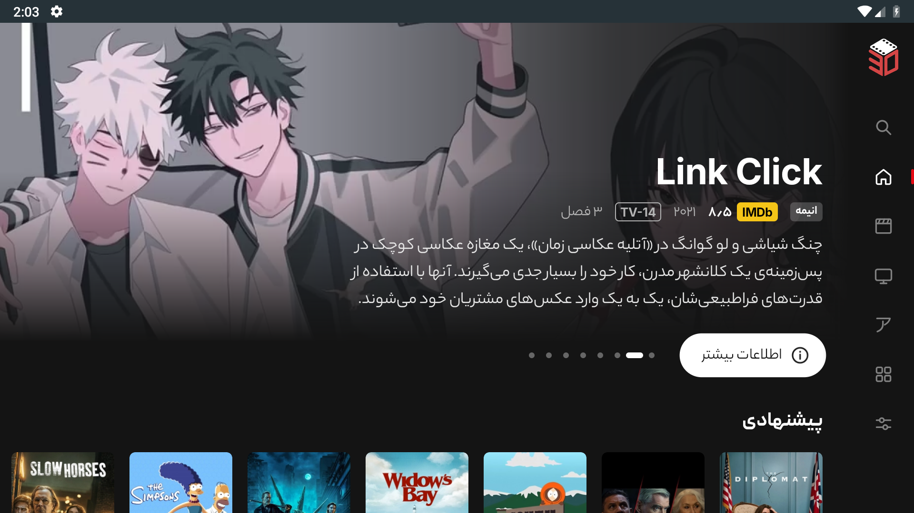<br>Home | 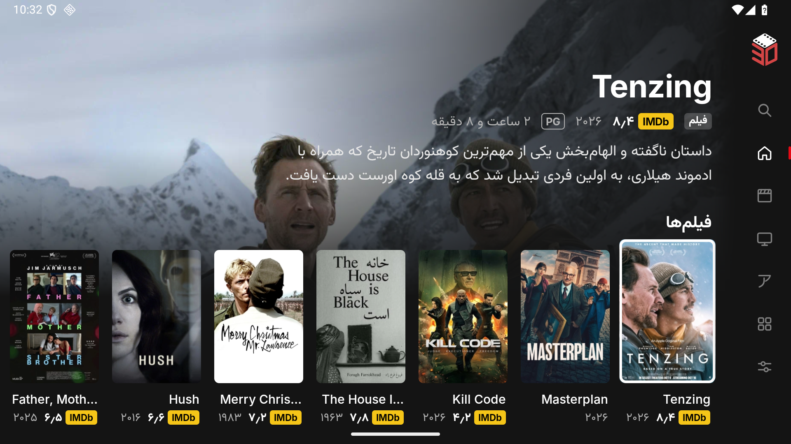<br>Home rows |
| 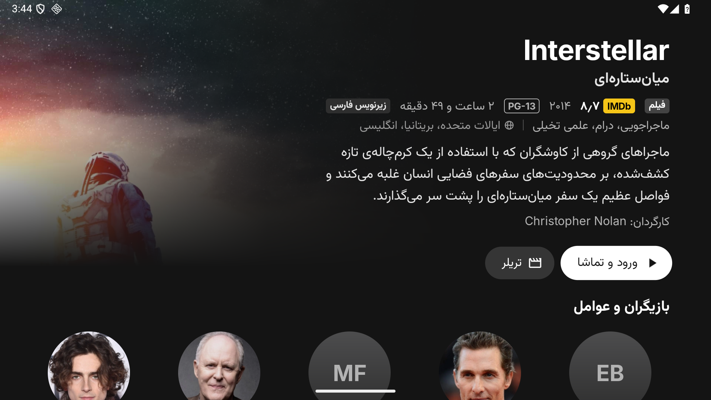<br>Title page | 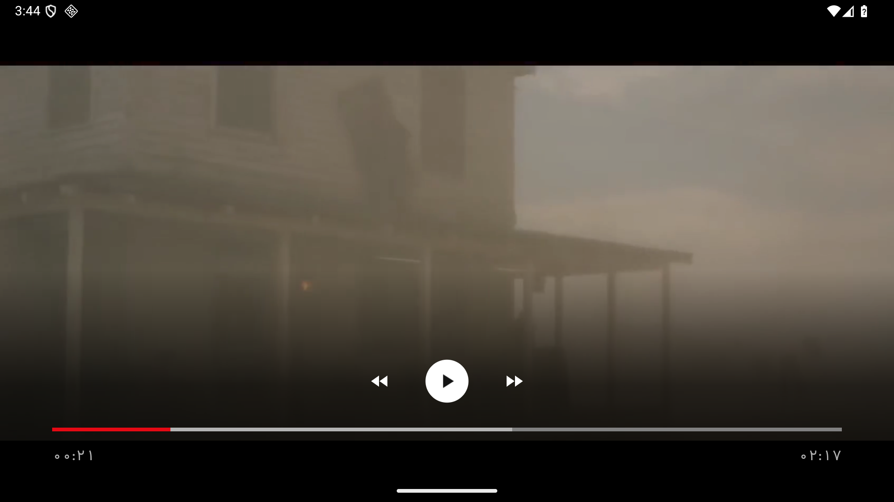<br>Trailer, played in the app |
| 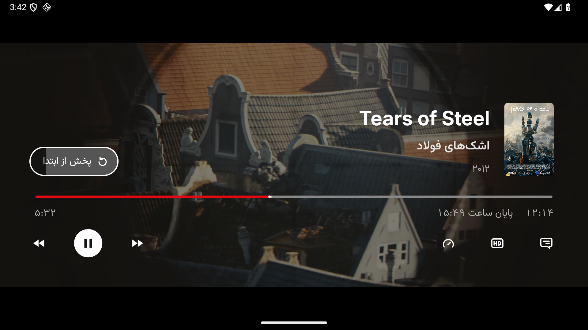<br>Resume | 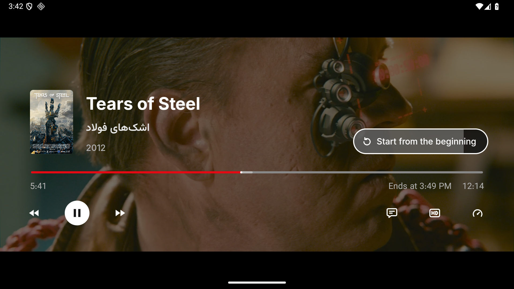<br>Player in English |
| 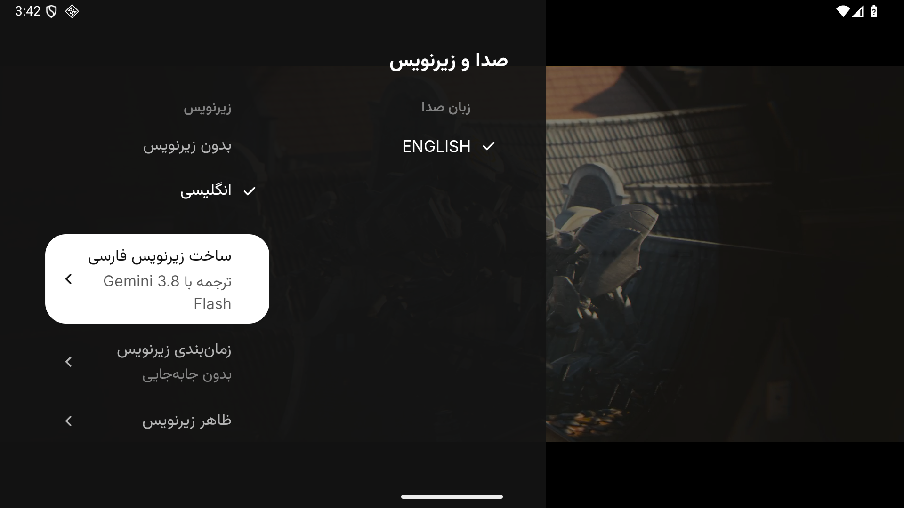<br>Make Persian subtitles | 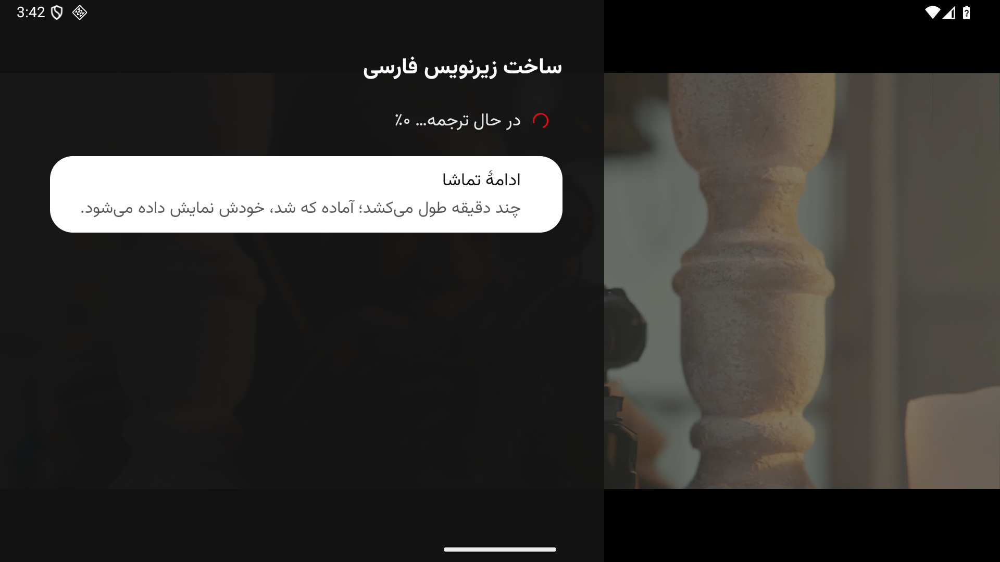<br>Translation under way |
| 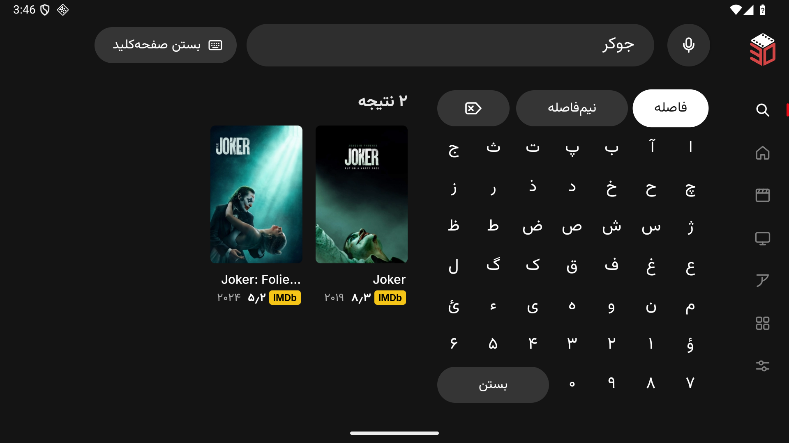<br>Search with the Persian keyboard | 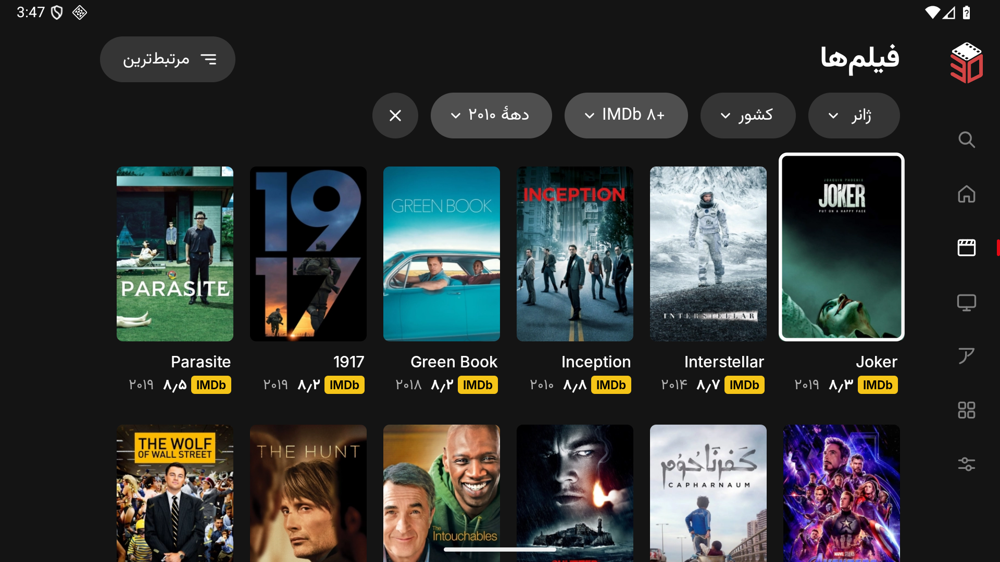<br>Movies, filtered |
| 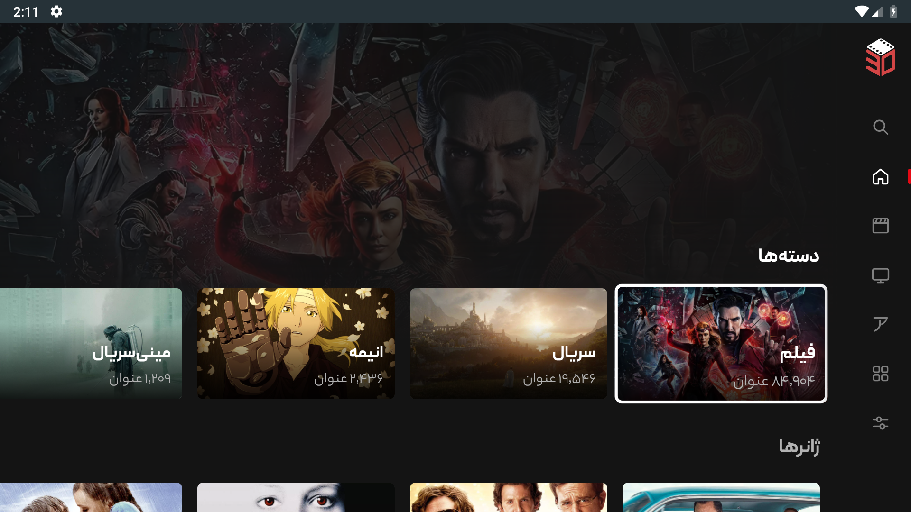<br>Categories and genres | 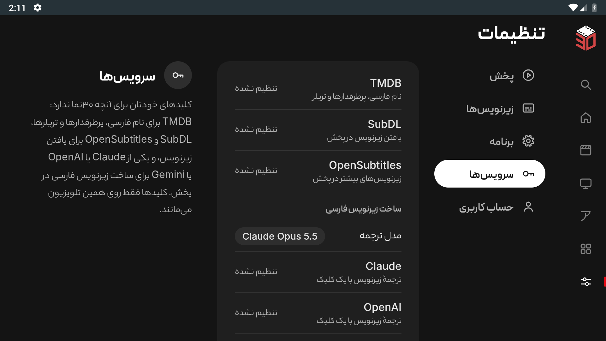<br>Settings: services |

Captured on an Android emulator ([details](DEVELOPMENT.md#screenshots)). The player screens play Blender's open film [Tears of Steel](https://mango.blender.org/) (CC BY 3.0, Blender Foundation; poster from [Wikimedia Commons](https://commons.wikimedia.org/wiki/File:Tos-poster.png)).

30nama's name and logo belong to 30nama. Publishing this app implies no affiliation with 30nama and no license to reuse its branding, and third-party fonts keep their owners' rights.
