<div dir="rtl">

# برنامهٔ 30namaTV

[English](README.en.md) · **فارسی**

برنامه‌ای **غیررسمی و مستقل** برای گشتن و تماشای ۳۰نما روی تلویزیون‌های اندرویدی، نوشته‌شده با کاتلین و ابزارهای خود اندروید (Leanback و Media3). **این برنامهٔ رسمی ۳۰نما نیست و ۳۰نما آن را نساخته یا تأیید نکرده است.** رابطش فارسی و انگلیسی است و همه‌چیز با دکمه‌های جهت‌نمای کنترل تلویزیون کار می‌کند. برای تماشای محتوای اشتراکی، حساب و اشتراک ۳۰نما لازم است.

[](https://github.com/soeleia/30namaTV/actions/workflows/android.yml)

برنامه روی اندروید 6.0 به بالا (API 23) نصب می‌شود. یک فایل نصبی برای همهٔ دستگاه‌هاست و برای اجرا به React Native نیازی ندارد. نسخه‌های انتشار با R8 بهینه و کوچک می‌شوند. تا اطلاعات حساب و منو برسد، گشتن در برنامه منتظر نمی‌ماند، پوسترها در همان اندازه‌ای که دیده می‌شوند بارگذاری می‌شوند و هر جست‌وجوی تازه، درخواست جست‌وجوی قبلی را لغو می‌کند.

نتیجه‌های جست‌وجو در شبکه‌ای شش‌ستونه می‌آیند و برای تلویزیونی که صفحه‌کلیدش فارسی ندارد، صفحه‌کلید فارسی خود برنامه آماده است. ردیف ژانرها در خانه همهٔ ژانرها را نشان می‌دهد و آخرش به صفحهٔ چهارستونهٔ ژانرها می‌رسد. فهرست فیلم‌ها، سریال‌ها و انیمه‌ها را می‌شود بر اساس ژانر، کشور، حداقل امتیاز IMDb و دهه محدود کرد، هر کدام به‌تنهایی یا با هم، و با هر کدام از شش ترتیب.

## امکانات

- **خانه:** عنوان‌های ویژهٔ ۳۰نما بالای صفحه با چپ و راست ورق می‌خورند و یک دکمهٔ «اطلاعات بیشتر» دارند؛ دکمهٔ پخش کنترل، خود عنوان را پخش می‌کند. خانه بلافاصله از آخرین نسخهٔ ذخیره‌شده نمایش داده می‌شود و بعد سر جای خودش تازه می‌شود. تصویر عنوان‌های کناری از قبل گرفته می‌شود، برای همین حرکت در ردیف‌ها به‌ندرت معطل می‌ماند.
- **پوسترها:** با نگه داشتن OK روی هر پوستر، کارهای سریع باز می‌شود: اطلاعات بیشتر، افزودن یا برداشتن از سه فهرست شما، و تریلر اگر باشد. در «ادامهٔ تماشا»، نگه داشتن OK امکان حذف عنوان از ردیف یا باز کردن صفحه‌اش را می‌دهد و عنوان حذف‌شده همان لحظه از ردیف برداشته می‌شود.
- **تریلر:** دکمهٔ «تریلر» در صفحهٔ هر عنوان، تریلر را در پخش‌کنندهٔ خود برنامه پخش می‌کند. در ایران نسخهٔ آپارات پخش می‌شود که فیلترشکن نمی‌خواهد و اغلب زیرنویس فارسی دارد، و بیرون از ایران تریلر یوتیوب استودیو؛ اگر یکی در دسترس نباشد، دیگری پخش می‌شود. نشان یوتیوب روی دکمه یعنی تریلر از یوتیوب می‌آید و با نگه داشتن OK روی دکمه می‌شود منبع را انتخاب کرد. پخش از یوتیوب به دسترسی به youtube.com و یک WebView از سال ۲۰۱۹ به بعد نیاز دارد.
- **جست‌وجو:** وقتی کادر خالی است، جست‌وجوهای اخیر بالای پیشنهادهای ۳۰نما برمی‌گردند. دکمهٔ «صفحه‌کلید فارسی» کنار کادر، صفحه‌کلید فارسی خود برنامه را باز می‌کند که با کنترل کار می‌کند و نیم‌فاصله، اعداد فارسی و «ی» و «ک» فارسی دارد.
- **پخش‌کننده:** بالای نوار زمان فقط اطلاعات عنوان می‌آید: پوستر، نام انگلیسی و نام فارسی، و زیرشان آنچه در حال پخش است با امتیاز IMDb و سال. زیر نوار، زمان سپری‌شده، طول فیلم و ساعت تمام شدنش، و یک ردیف دکمه مثل یوتیوب قرار دارد. کنترل‌ها روی دکمهٔ پخش و توقف باز می‌شوند. چپ و راست، فیلم را پنج ثانیه پنج ثانیه جلو و عقب می‌برند و اگر نگهشان دارید تندتر می‌شوند؛ یک ثانیه بعد از آخرین فشار، پخش از همان‌جا ادامه پیدا می‌کند. بخش روشن نوار نشان می‌دهد چه مقدار از فیلم آماده است، از جمله آنچه از قبل روی حافظه ذخیره شده («تنظیمات ← پخش ← پیش‌بارگذاری»)، و ابتدای قسمت بعد هم هنگام تیتراژ پایانی گرفته می‌شود.
- **ادامهٔ تماشا:** دکمهٔ پخش و ردیف «ادامهٔ تماشا» از همان جایی ادامه می‌دهند که فیلم را رها کرده‌اید. تلویزیون برای هر عنوان، نقطهٔ دقیق خودش را نگه می‌دارد، چون نقطه‌ای که ۳۰نما ذخیره می‌کند گاهی عقب‌تر می‌ماند؛ از این دو، هر کدام جلوتر باشد ملاک است. عنوانی که از وسط ادامه پیدا می‌کند، تا ده ثانیه دکمهٔ «پخش از ابتدا» را نشان می‌دهد.
- **زیرنویس:** «یافتن زیرنویس» زیرنویس همان فیلم یا همان قسمت را در SubSource (سایتی که خود ۳۰نما به آن پیوند می‌دهد) بدون کلید و در SubDL و OpenSubtitles با کلید خودشان پیدا می‌کند، اول فارسی و در هر زبان اول زیرنویسی که با نسخهٔ در حال پخش جورتر است، و فایل انتخاب‌شده را بدون توقف پخش بار می‌کند؛ فایل‌های قدیمی فارسی با کدگذاری Windows-1256 هم درست خوانده می‌شوند. «ساخت زیرنویس فارسی» زیرنویس انگلیسی را (زیرنویس خود ۳۰نما یا یکی از سایت‌های زیرنویس) با Claude، OpenAI یا Gemini به فارسی روان و گفتاری ترجمه می‌کند. این کار چند دقیقه طول می‌کشد، فیلم در این مدت پخش می‌شود و زیرنویس که آماده شد خودش روشن می‌شود. «زمان‌بندی زیرنویس» هر زیرنویسی را ربع ثانیه ربع ثانیه جلو یا عقب می‌برد. زیرنویس فارسی با «ی»، «ک» و اعداد فارسی نمایش داده می‌شود و فایلی که برای پخش‌کننده‌های چپ‌به‌راست نوشته شده (یعنی نقطه را اول خط گذاشته) همان‌طور که نوشته شده چیده می‌شود.
- **قسمت‌ها:** قسمت‌های دیده‌شده تیک می‌خورند، قسمت‌های نیمه‌کاره نوار پیشرفت و دقیقه‌های باقی‌مانده دارند و دکمهٔ پخش از همان‌جایی که هستید ادامه می‌دهد. این سابقه روی خود تلویزیون نگه داشته می‌شود (۳۰نما برای هر عنوان فقط یک نقطه نگه می‌دارد) و با خروج از حساب پاک می‌شود.
- **صفحهٔ اصلی تلویزیون:** «ادامهٔ تماشا» در ردیف Play Next صفحهٔ اصلی تلویزیون هم هست و هر عنوان از همان‌جا، بدون باز کردن برنامه، ادامه پیدا می‌کند. قسمتی که تا آخر دیده شده، جایش را به قسمت بعد می‌دهد که با انتخابش مستقیم پخش می‌شود. وقتی قسمت تازهٔ سریالی که تماشا می‌کنید یا در فهرست «اطلاع‌رسانی» گذاشته‌اید منتشر می‌شود، همین ردیف خبر می‌دهد و پوستر آن سریال در «ادامهٔ تماشا» به‌جای زمان باقی‌مانده، کنار یک نقطهٔ قرمز «قسمت تازه» را نشان می‌دهد. هر عنوانی را که از آن ردیف بردارید، تا پیشنهاد تازه‌ای برایش نباشد برنمی‌گردد و با خروج از حساب، همهٔ این‌ها پاک می‌شود.

## نصب

فایل `30namaTV.apk` را از [صفحهٔ Releases](https://github.com/soeleia/30namaTV/releases) بگیرید، یا بستهٔ `optimized-apk` را از یک [اجرای موفق Actions](https://github.com/soeleia/30namaTV/actions).

در تلویزیون، نصب از مدیر فایلی را که استفاده می‌کنید مجاز کنید و فایل APK را باز کنید، یا با ADB نصبش کنید:

<div dir="ltr">

```sh
adb connect YOUR_TV_IP:5555
adb -s YOUR_TV_IP:5555 install -r 30namaTV.apk
```

</div>

شناسهٔ برنامه `com.doxigo.tv30` است. نسخه‌های عمومی همه با یک کلید انتشار امضا می‌شوند تا هر نسخهٔ تازه روی قبلی به‌روزرسانی شود. نسخه‌های آزمایشی شخصی قبلی کلید دیگری داشتند: برای رفتن از آن‌ها به نسخهٔ عمومی باید نسخهٔ قدیمی را پاک کنید، که تنظیمات و ورود ذخیره‌شده‌اش را هم پاک می‌کند. فایل آزمایشی جداگانه‌ای که برای تلویزیون فرستاده شده، همان کلید آزمایشی اصلی را دارد و روی نسخهٔ قبلی نصب می‌شود.

## به‌روزرسانی

هر بار که صفحهٔ اصلی جلو می‌آید (موقع باز شدن برنامه، برگشتن از پخش یا روشن شدن تلویزیون)، برنامه آخرین نسخهٔ پایدار گیت‌هاب را بررسی می‌کند، حداکثر هر شش ساعت یک بار، و اگر نسخهٔ تازه‌تری باشد آن را با Download Manager اندروید خودکار دانلود می‌کند. دانلود در پس‌زمینه ادامه پیدا می‌کند. وقتی نسخهٔ تازه دانلود و بررسی شد، صفحهٔ اصلی در گوشهٔ بالایش خبر می‌دهد: «نسخهٔ ۱.۵.۰ آماده است» با «نصب». روی عنوان ویژه دکمهٔ بالا را بزنید تا به آن برسید و با تأیید نصبش کنید. دکمهٔ بازگشت این خبر را می‌بندد و برای همان نسخه دیگر نشانش نمی‌دهد، ولی نقطه‌ای قرمز روی نماد «تنظیمات» در نوار کناری می‌ماند تا نسخه نصب شود. این نقطه شما را مستقیم به «تنظیمات ← برنامه ← به‌روزرسانی» می‌برد؛ آن‌جا هم پیشرفت دانلود را می‌بینید، دوباره بررسی می‌کنید یا نسخهٔ آماده را نصب می‌کنید. اندروید برای نصب تأیید می‌خواهد و شاید لازم باشد اجازهٔ نصب از این برنامه را بدهید.

برنامه پیش از نصب، نام بسته، بالاتر بودن شمارهٔ نسخه و گواهی امضا را بررسی می‌کند و فایل ناسازگار یا نامعتبر را نصب نمی‌کند. اولین جابه‌جایی از کلید آزمایشی شخصی به کلید انتشار عمومی همچنان همان نصب دستی بالا را لازم دارد.

## کلیدهای سرویس

سرویس TMDB، جست‌وجوی زیرنویس در پخش‌کننده و ساخت زیرنویس فارسی با کلید API کار می‌کنند و هر بیننده کلید خودش را وارد می‌کند. در «تنظیمات ← سرویس‌ها» یک سرویس را انتخاب کنید. کد QR را با گوشی‌ای که به همان وای‌فای وصل است اسکن کنید: صفحه‌ای باز می‌شود که خود تلویزیون آن را می‌سازد، جایی را که کلید ساخته می‌شود نشانتان می‌دهد و کلیدی را که در آن بچسبانید مستقیم به تلویزیون می‌فرستد. کلید را با صفحه‌کلید تلویزیون یا برنامهٔ Google TV هم می‌شود تایپ کرد، یا «جای‌گذاری» را زد. برنامه کلید را آزمایش می‌کند، می‌گوید کار می‌کند یا نه، و آن را در حافظهٔ خصوصی خودش روی همان تلویزیون نگه می‌دارد. بدون کلید، آن امکان خاموش می‌ماند؛ گشتن در برنامه و پخش ۳۰نما به هیچ کلیدی نیاز ندارد.

- **سرویس TMDB:** ردیف «ترندهای هفته»، نام فارسی عنوان‌هایی که ۳۰نما ندارد، لوگوی عنوان به جای نام انگلیسی، شعار فیلم و وضعیت و شبکهٔ سریال، «عناوین مشابه»، تریلرها و تصویر قسمت‌ها را اضافه می‌کند. صفحهٔ API آن هم API key می‌دهد و هم API read access token؛ هر کدام کار می‌کند.
- **سایت‌های SubDL و OpenSubtitles:** زیرنویس‌هایشان را کنار زیرنویس‌های SubSource به «یافتن زیرنویس» پخش‌کننده («صدا و زیرنویس» ← «زیرنویس») اضافه می‌کنند؛ خود «یافتن زیرنویس» کلید نمی‌خواهد. کلید رایگان OpenSubtitles روزی پنج زیرنویس دانلود می‌کند.
- **مدل‌های Claude، OpenAI و Gemini:** «ساخت زیرنویس فارسی» را در همان ستون راه می‌اندازند. «مدل ترجمه» بالای کلیدهایشان، مدل و همراهش سرویس را انتخاب می‌کند: Claude Opus 5.5 (وفادارترین ترجمهٔ فارسی، حدود ۰٫۹۲ دلار برای یک فیلم دوساعته)، Claude Sonnet 5.5 یا GPT-6.1 Sol (حدود ۰٫۴۶ دلار)، GPT-6 Astra (حدود ۲٫۳۰ دلار) یا Gemini 3.8 Flash (در سهمیهٔ رایگان Gemini مجانی است، ولی بیشتر اشتباه می‌کند). تا مدلی انتخاب نکرده باشید، بهترین مدل اولین سرویسی که کلید دارد، به همین ترتیب، ترجمه می‌کند؛ هزینهٔ مدل‌های پولی از حساب خود شما کم می‌شود. نتیجه روی تلویزیون می‌ماند و دوباره دیدن فیلم هزینه‌ای ندارد. این سرویس‌ها از ایران بدون فیلترشکن وصل نمی‌شوند.

## ساخت از روی کد

برنامهٔ Android Studio، نسخهٔ 21 از JDK و این بسته‌های SDK را نصب کنید:

<div dir="ltr">

```sh
sdkmanager 'platforms;android-37.0' 'build-tools;36.0.0' 'build-tools;37.0.0' 'platform-tools'
git clone https://github.com/soeleia/30namaTV.git
cd 30namaTV
printf 'sdk.dir=%s\n' "$ANDROID_HOME" > local.properties
./gradlew :app:assembleRelease
```

</div>

فایل نصبی در `app/build/outputs/apk/release/app-release.apk` ساخته می‌شود. نسخهٔ 21 از JDK که همراه Android Studio می‌آید هم کار می‌کند و Gradle Wrapper چک‌سام توزیع خودش را بررسی می‌کند. ساخت محلی با کلید debug اندروید شما امضا می‌شود، مگر اینکه هر چهار متغیر `RELEASE_*` را بدهید ([راهنمای راه‌اندازی و انتشار](docs/setup.md)).

مخزن عمومی فونت‌های Inter و Vazirmatn را با مجوز OFL همراه دارد و بدون فایل‌های فونت خصوصی ساخته می‌شود. نسخه‌هایی که نگهدارنده منتشر می‌کند تیترهای Peyda و متن Yekan Bakh را دارند؛ [فونت‌ها و ورودی‌های ساخت](docs/setup.md#fonts) را ببینید. متن انگلیسی همه‌جا با Inter است.

نسخه‌های عمومی هیچ کلید API ندارند ([کلیدهای سرویس](#کلیدهای-سرویس) را ببینید). برای ساخت‌های خودتان، فایل `local.properties` که گیت آن را نادیده می‌گیرد می‌تواند کلیدهای جایگزین را نگه دارد تا وقتی کلیدی در تنظیمات ذخیره نشده، از آن‌ها استفاده شود: `tmdb.token=`، `subdl.key=`، `opensubtitles.key=`، `gemini.key=`، `anthropic.key=` و `openai.key=` ([جزئیات](docs/setup.md#service-keys)). کلیدی که داخل APK ساخته شود قابل استخراج است، پس فایلی را که با کلیدهای خودتان ساخته‌اید به کسی ندهید و هیچ‌وقت رمز حسابی را آنجا نگذارید.

## بررسی‌ها و تصویرها

<div dir="ltr">

```sh
./gradlew :app:testDebugUnitTest :app:lintRelease :app:assembleDebug :app:assembleDebugAndroidTest
python3 scripts/tv-checks.py --serial emulator-5554
```

</div>

این بررسی‌ها را روی یک شبیه‌ساز یک‌بارمصرف اجرا کنید. آن‌ها تنظیمات محلی را عوض می‌کنند و با داده‌های ساختگی حساب کار می‌کنند و اجراکننده‌شان دستگاه واقعی را نمی‌پذیرد. این بررسی‌ها شروع برنامه و لغو درخواست‌ها، لوگوی متحرک، پنهان شدن کنترل‌ها، جلو و عقب رفتن، چیدمان و جهت زیرنویس، ساخت زیرنویس فارسی، ادامهٔ تماشا و دکمهٔ «پخش از ابتدا»، قسمت‌های دیده‌شده، حذف از «ادامهٔ تماشا»، کامل ماندن امتیاز و سال زیر پوسترها با رابط انگلیسی، فهرست‌ها، جست‌وجو و صفحه‌کلید فارسی، صفحهٔ ژانرها، فیلترهای فهرست‌ها، به‌روزرسانی (با خبر صفحهٔ اصلی و نقطهٔ قرمز «تنظیمات») و تریلر را پوشش می‌دهند.

بررسی تریلر، تریلر عمومی Animals را امتحان می‌کند. اگر CDN آن در دسترس نباشد، لاگ‌ها `PUBLIC_UNAVAILABLE` را نشان می‌دهند و بررسی تعامل و چرخهٔ عمر با یک فایل بی‌صدا انجام می‌شود. چنین نتیجه‌ای پخش زنده از CDN را تأیید نمی‌کند.

در GitHub Actions، نسخهٔ debug ابزارگذاری‌شده روی شبیه‌ساز تلویزیون اندروید 11 با دو هسته و ۱٫۵ گیگابایت رم اجرا می‌شود. فایل نصبی بهینه‌شده هم بررسی کامل lint، امضا و ترازبندی ZIP را می‌گذراند. هر اجرا فایل‌های نصبی، گزارش‌های lint و آزمون‌ها، لاگ‌ها و تصویرها را نگه می‌دارد. [راهنمای راه‌اندازی و انتشار](docs/setup.md)، [بررسی دستی روی تلویزیون سونی](docs/testing.md) و [شواهد کارایی](docs/performance.md) را ببینید. زمان‌بندی روی شبیه‌ساز چیزی دربارهٔ کارایی روی تلویزیون سونی ۲۰۱۷ ثابت نمی‌کند.

## تصویرها

| | |
|:-:|:-:|
| 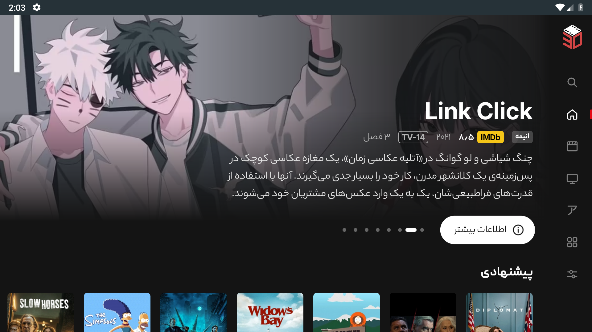<br>خانه | 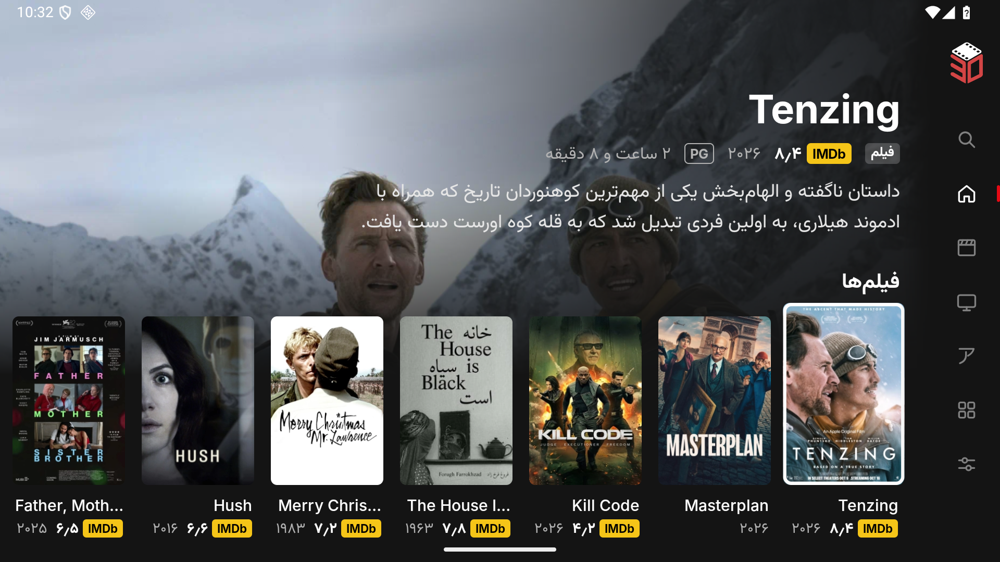<br>ردیف‌های خانه |
| 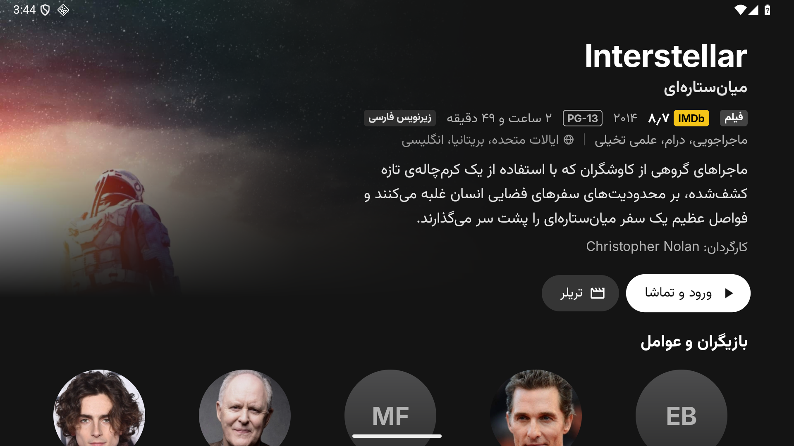<br>صفحهٔ عنوان | 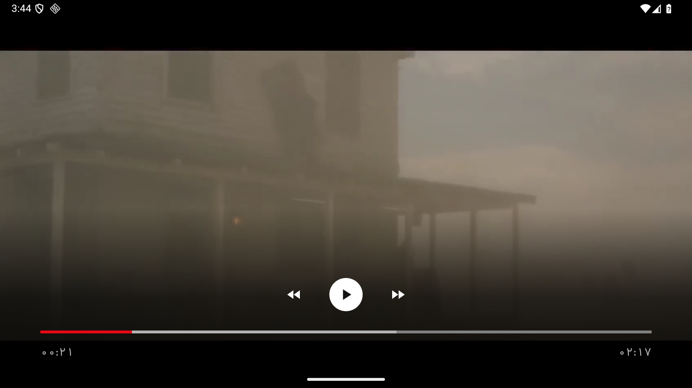<br>تریلر در خود برنامه |
| 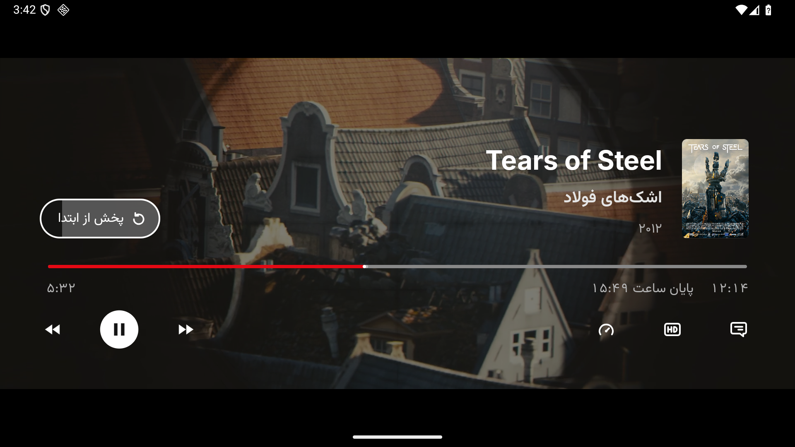<br>پخش‌کننده، ادامهٔ تماشا | 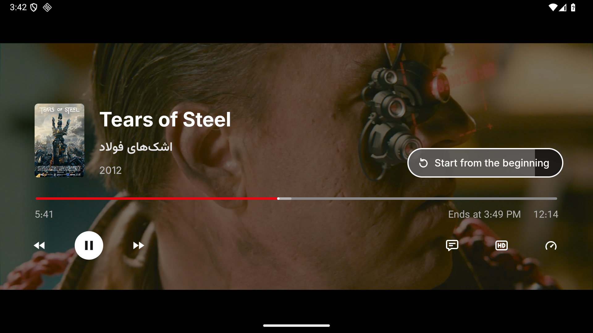<br>پخش‌کننده با رابط انگلیسی |
| 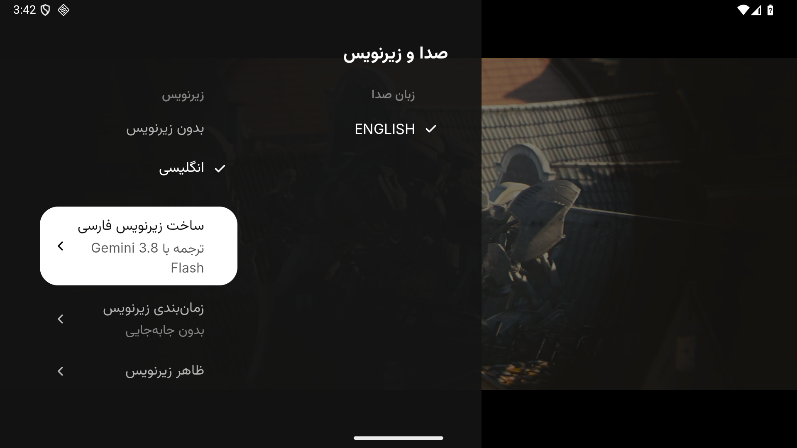<br>ساخت زیرنویس فارسی | 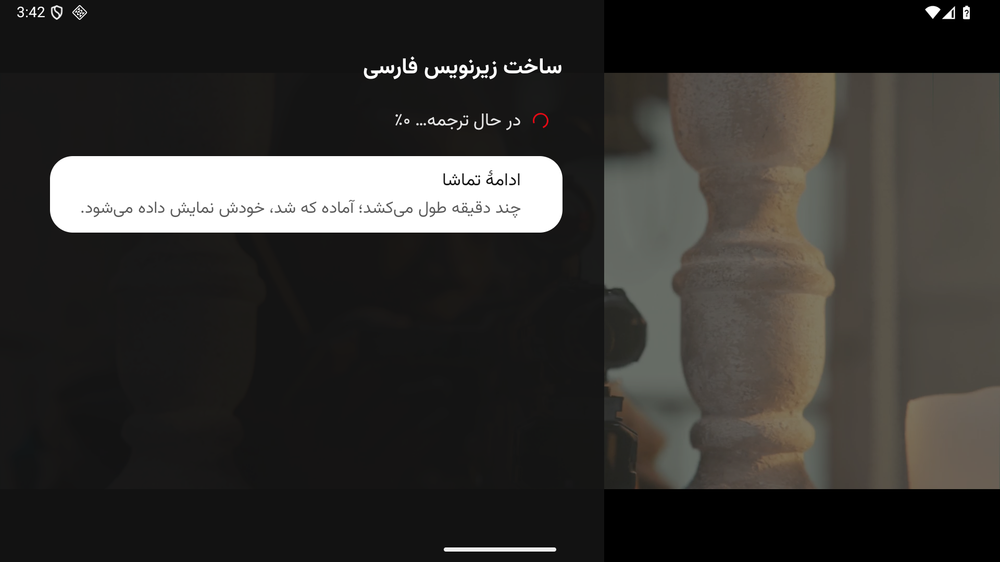<br>ترجمه در حال انجام |
| 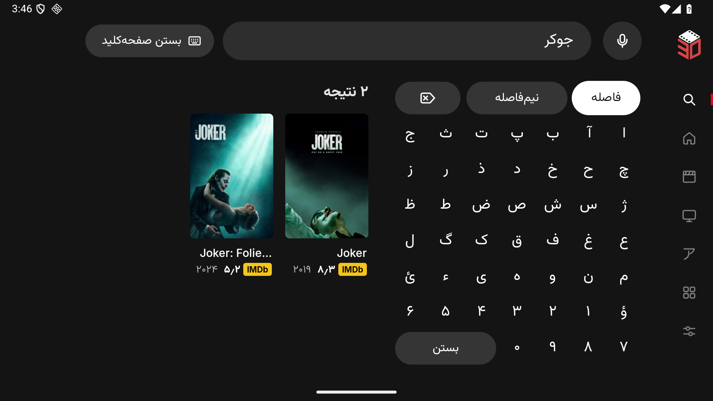<br>جست‌وجو با صفحه‌کلید فارسی | 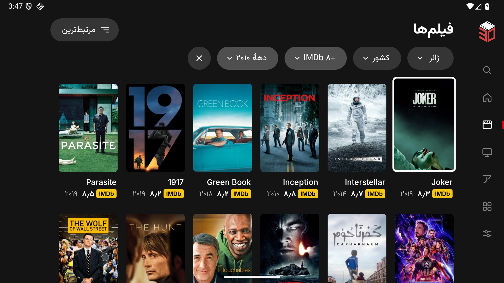<br>فیلم‌ها، با فیلتر |
| 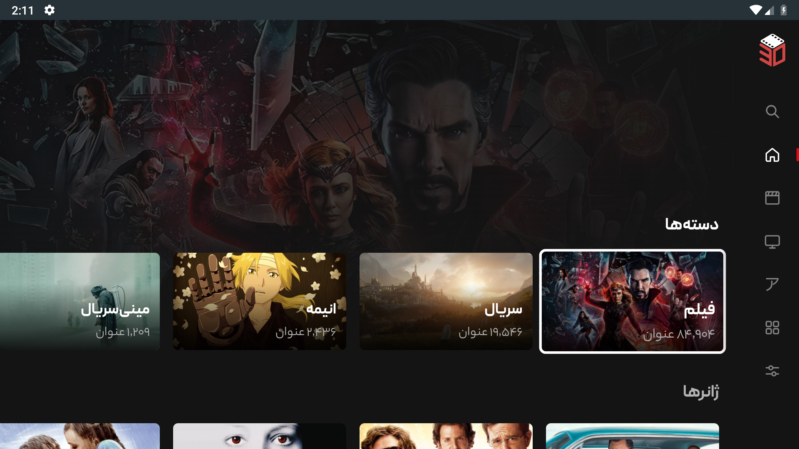<br>دسته‌ها و ژانرها | 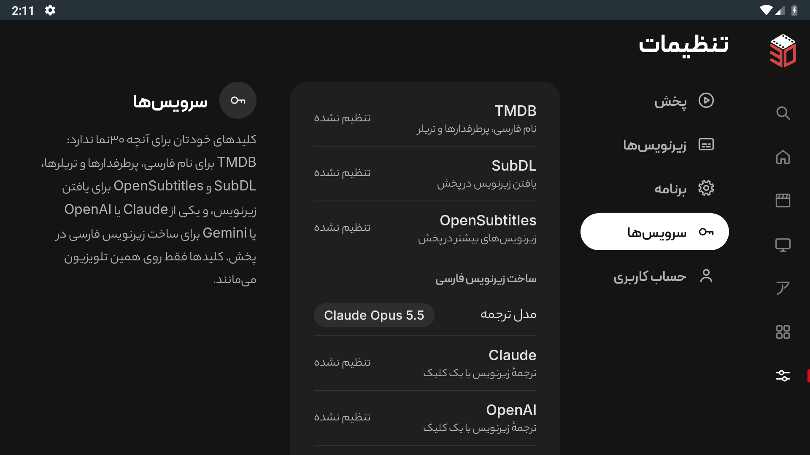<br>تنظیمات: سرویس‌ها |

تصویرهای گشتن در برنامه، نسخهٔ بهینه‌شدهٔ انتشار را روی فهرست زندهٔ ۳۰نما و با ورود مهمان نشان می‌دهند، روی یک شبیه‌ساز یک‌بارمصرف اندروید 16 و پس از بارگذاری تصویرها. تریلر بازنشر آپارات است و واترمارک بارگذارکننده‌اش را دارد. مهمان نمی‌تواند عنوان‌های ۳۰نما را پخش کند، برای همین تصویرهای پخش‌کننده و «ساخت زیرنویس فارسی» فیلم آزاد [Tears of Steel](https://mango.blender.org/) از بنیاد بلندر را (با مجوز CC BY 3.0؛ پوستر از [ویکی‌مدیا کامانز](https://commons.wikimedia.org/wiki/File:Tos-poster.png)) از یک جریان آزمایشی عمومی پخش می‌کنند. در این تصویرها یک نسخهٔ debug ابزارگذاری‌شده به جای پاسخ ۳۰نما، نام فیلم، سال و نقطهٔ ذخیره‌شده را می‌دهد و نام فارسی فیلم را ما گذاشته‌ایم. ترجمهٔ نشان‌داده‌شده تازه شروع شده و مدلی که جای سرویس واقعی گذاشته شده هیچ‌وقت جواب نمی‌دهد، برای همین هیچ متن ترجمه‌شده‌ای در تصویرها نیست. در تصویرها هیچ اطلاعات خصوصی حسابی نیست. نوار وضعیت شبیه‌ساز پیداست؛ این‌ها تصویربرداری مستقیم و بی‌دستکاری‌اند، نه عکس از تلویزیون واقعی. لوگو و انیمیشن بارگذاری اصلی در [سند منشأ نشان تجاری](docs/branding.md) آمده‌اند. حقوق نشان تجاری ۳۰نما و مجوز فونت‌های دیگران برای صاحبانشان محفوظ است؛ انتشار این برنامه به معنای وابستگی به آن‌ها یا اجازهٔ استفادهٔ جداگانه از این دارایی‌ها نیست.

</div>
