<div dir="rtl">

# برنامهٔ 30namaTV

**فارسی** · [English](README.en.md)

برنامه‌ای غیررسمی برای تماشای ۳۰نما روی تلویزیون‌های اندرویدی. با کاتلین و ابزارهای خود اندروید (Leanback و Media3) نوشته شده، همه‌چیزش با کنترل تلویزیون کار می‌کند و رابطش فارسی و انگلیسی است.

**این برنامهٔ رسمی ۳۰نما نیست و ۳۰نما آن را نساخته یا تأیید نکرده است.** برای تماشای محتوای اشتراکی، حساب و اشتراک ۳۰نما لازم است. برنامه روی اندروید ۶ و بالاتر نصب می‌شود.

[](https://github.com/soeleia/30namaTV/actions/workflows/android.yml)

## امکانات

- خانه از آخرین نسخهٔ ذخیره‌شده فوراً نمایش داده می‌شود و بعد، بی‌آنکه جای شما در صفحه عوض شود، تازه می‌شود. عنوان‌های ویژهٔ ۳۰نما بالای صفحه با چپ و راست ورق می‌خورند و دکمهٔ پخش کنترل، همان عنوان را پخش می‌کند.
- با نگه داشتن OK روی هر پوستر، منوی کوتاهی باز می‌شود: «اطلاعات بیشتر»، افزودن به سه لیست شما (علاقه‌مندی‌ها، لیست تماشا و اطلاع‌رسانی) یا حذف از آن‌ها، و تریلر. در «ادامهٔ تماشا» همین منو عنوان را از ردیف حذف می‌کند.
- برای تلویزیون‌هایی که صفحه‌کلید فارسی ندارند، برنامه صفحه‌کلید فارسی خودش را دارد که با دکمهٔ «صفحه‌کلید فارسی» کنار کادر جست‌وجو باز می‌شود. وقتی کادر خالی است، جست‌وجوهای اخیر و پیشنهادهای ۳۰نما نمایش داده می‌شوند.
- فیلم‌ها، سریال‌ها و انیمه‌ها را می‌توانید بر اساس ژانر، کشور، حداقل امتیاز IMDb و دهه فیلتر و به شش روش مرتب کنید. ردیف ژانرها در خانه همهٔ ژانرها را دارد و به صفحهٔ کامل ژانرها می‌رسد.
- تریلر در خود برنامه پخش می‌شود: در ایران از آپارات، بدون فیلترشکن و اغلب با زیرنویس فارسی، و بیرون از ایران از یوتیوب. اگر یکی در دسترس نباشد، دیگری پخش می‌شود و با نگه داشتن OK روی دکمهٔ «تریلر» می‌توانید منبع را خودتان انتخاب کنید. تریلرهای یوتیوب روی تلویزیون‌هایی که WebView قدیمی‌تر از سال ۲۰۱۹ دارند پخش نمی‌شوند.
- پخش‌کننده خلوت است: بالای نوار زمان فقط پوستر و نام عنوان می‌آید و پایینش زمان سپری‌شده، طول فیلم و ساعت تمام شدنش. چپ و راست فیلم را پنج ثانیه جلو و عقب می‌برند و اگر نگهشان دارید، تندتر می‌شوند. ابتدای قسمت بعد هنگام تیتراژ پایانی بارگذاری می‌شود و با «تنظیمات ← پخش ← پیش‌بارگذاری» بخش بیشتری از فیلم از قبل روی حافظهٔ تلویزیون ذخیره می‌شود.
- پخش از همان جایی ادامه پیدا می‌کند که رها کرده‌اید. تلویزیون جای دقیق هر عنوان را خودش هم نگه می‌دارد، چون نقطه‌ای که ۳۰نما ذخیره می‌کند گاهی عقب‌تر است. وقتی پخش از وسط ادامه پیدا می‌کند، تا ده ثانیه دکمهٔ «پخش از ابتدا» نمایش داده می‌شود.
- قسمت‌های دیده‌شدهٔ سریال تیک می‌خورند و قسمت‌های نیمه‌کاره نوار پیشرفت و دقیقه‌های باقی‌مانده دارند. این سابقه روی خود تلویزیون ذخیره می‌شود و با خروج از حساب پاک می‌شود.
- در منوی «صدا و زیرنویس» پخش‌کننده، سه ابزار برای زیرنویس هست:
  - «یافتن زیرنویس» زیرنویس همان فیلم یا قسمت را از SubSource پیدا می‌کند، و اگر کلیدشان را وارد کرده باشید از SubDL و OpenSubtitles هم. زیرنویس‌های فارسی و آن‌هایی که با نسخهٔ در حال پخش هماهنگ‌ترند اول می‌آیند و زیرنویس انتخاب‌شده بدون توقف پخش بار می‌شود.
  - «ساخت زیرنویس فارسی» زیرنویس انگلیسی را با Claude، OpenAI یا Gemini به فارسی روان ترجمه می‌کند. ترجمه چند دقیقه طول می‌کشد و فیلم در این مدت پخش می‌شود. وقتی زیرنویس آماده شد، خودش روشن می‌شود.
  - «زمان‌بندی زیرنویس» زیرنویسی را که با صدا هماهنگ نیست، ربع ثانیه ربع ثانیه جلو یا عقب می‌برد.

  زیرنویس‌های فارسی با «ی»، «ک» و اعداد فارسی نمایش داده می‌شوند. فایل‌های قدیمی و فایل‌هایی که برای پخش‌کننده‌های چپ‌به‌راست ساخته شده‌اند هم درست خوانده و چیده می‌شوند.
- ردیف «ادامهٔ تماشا» در صفحهٔ اصلی خود تلویزیون (ردیف Play Next) هم هست و هر عنوان را می‌شود از همان‌جا، بدون باز کردن برنامه، ادامه داد. قسمتی که تمام شده جایش را به قسمت بعد می‌دهد. وقتی سریالی که تماشا می‌کنید یا در «اطلاع‌رسانی» گذاشته‌اید قسمت تازه‌ای پیدا کند، همین ردیف خبر می‌دهد و روی پوسترش در «ادامهٔ تماشا» نشان «قسمت تازه» می‌آید.

## نصب

فایل `30namaTV.apk` را از [صفحهٔ Releases](https://github.com/soeleia/30namaTV/releases) دانلود کنید. در تلویزیون به مدیر فایل اجازهٔ نصب برنامه بدهید و فایل را باز کنید، یا از رایانه با ADB نصبش کنید:

<div dir="ltr">

```sh
adb connect YOUR_TV_IP:5555
adb -s YOUR_TV_IP:5555 install -r 30namaTV.apk
```

</div>

اگر یکی از نسخه‌های آزمایشی اولیه را دارید و نسخهٔ تازه رویش نصب نمی‌شود، اول آن را حذف کنید. با این کار تنظیمات و ورود به حساب هم پاک می‌شوند.

## به‌روزرسانی

با هر بار باز شدن خانه، اگر شش ساعت از آخرین بررسی گذشته باشد، برنامه سراغ نسخهٔ تازه در گیت‌هاب می‌رود و اگر پیدا کند، در پس‌زمینه دانلودش می‌کند. وقتی آماده شد، بالای خانه پیام «نسخهٔ … آماده است» با دکمهٔ «نصب» نمایش داده می‌شود. اگر پیام را ببندید، نقطه‌ای قرمز روی «تنظیمات» می‌ماند تا نسخه را از «تنظیمات ← برنامه ← به‌روزرسانی» نصب کنید.

اندروید پیش از نصب تأیید می‌خواهد و شاید بار اول بخواهد اجازهٔ نصب از این برنامه را بدهید. برنامه فقط فایلی را نصب می‌کند که نسخه‌اش تازه‌تر باشد و با همان کلید امضا شده باشد.

## سرویس‌های اختیاری

گشتن در برنامه و تماشای ۳۰نما به هیچ کلیدی نیاز ندارد. چند امکان جانبی با کلید API سرویس‌های دیگر کار می‌کنند و هر بیننده کلید خودش را وارد می‌کند:

- سرویس TMDB ردیف «ترندهای هفته»، «عناوین مشابه»، لوگوی عنوان‌ها، تریلرهای یوتیوب، تصویر قسمت‌ها و نام فارسی عنوان‌هایی را که در ۳۰نما نام فارسی ندارند اضافه می‌کند. هم API key و هم API read access token آن کار می‌کند.
- سایت‌های SubDL و OpenSubtitles نتیجه‌های بیشتری به «یافتن زیرنویس» اضافه می‌کنند. کلید رایگان OpenSubtitles روزی پنج زیرنویس دانلود می‌کند.
- سرویس‌های Claude، OpenAI و Gemini «ساخت زیرنویس فارسی» را فعال می‌کنند و مدل را در «مدل ترجمه» انتخاب می‌کنید. هزینهٔ تقریبی ترجمهٔ یک فیلم دوساعته:
  - مدل Claude Opus 5.5، دقیق‌ترین ترجمهٔ فارسی: حدود ۰٫۹۲ دلار
  - مدل‌های Claude Sonnet 5.5 و GPT-6.1 Sol: حدود ۰٫۴۶ دلار
  - مدل GPT-6 Astra: حدود ۲٫۳۰ دلار
  - مدل Gemini 3.8 Flash: در سهمیهٔ رایگان Gemini مجانی است، ولی بیشتر اشتباه می‌کند

  اگر مدلی انتخاب نکنید، بهترین مدل اولین سرویسی که کلیدش را دارید، به همین ترتیب، ترجمه می‌کند. هزینه از حساب خودتان کم می‌شود و ترجمه روی تلویزیون می‌ماند، پس دوباره دیدن فیلم خرجی ندارد. این سرویس‌ها از ایران فقط با فیلترشکن در دسترس‌اند.

برای وارد کردن کلید، در «تنظیمات ← سرویس‌ها» سرویس را انتخاب کنید و کد QR را با گوشی‌ای که به همان وای‌فای وصل است اسکن کنید. صفحه‌ای باز می‌شود که نشانی ساخت کلید را دارد و کلیدی را که در آن بچسبانید، مستقیم به تلویزیون می‌فرستد. می‌توانید کلید را با صفحه‌کلید تلویزیون هم تایپ کنید یا دکمهٔ «جای‌گذاری» را بزنید. برنامه کلید را آزمایش می‌کند و فقط روی همان تلویزیون نگهش می‌دارد.

## ساخت از روی کد

راهنمای ساخت، بررسی‌ها و انتشار نسخه، به انگلیسی، در [DEVELOPMENT.md](DEVELOPMENT.md) آمده است.

## تصویرها

| | |
|:-:|:-:|
| 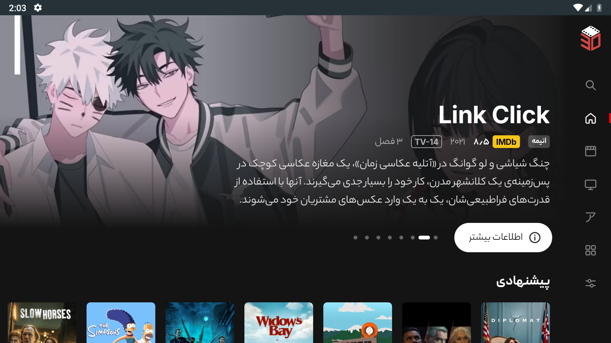<br>خانه | 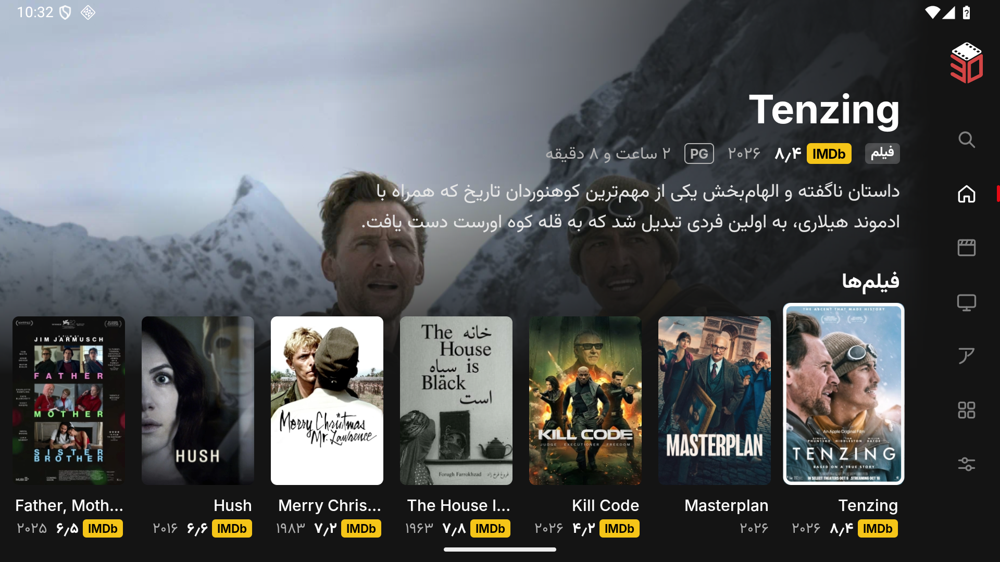<br>ردیف‌های خانه |
| 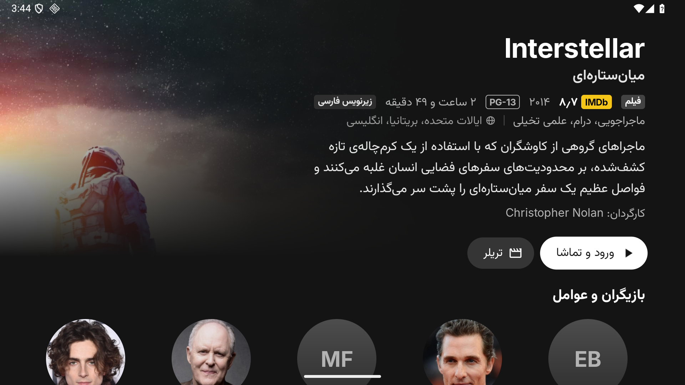<br>صفحهٔ عنوان | 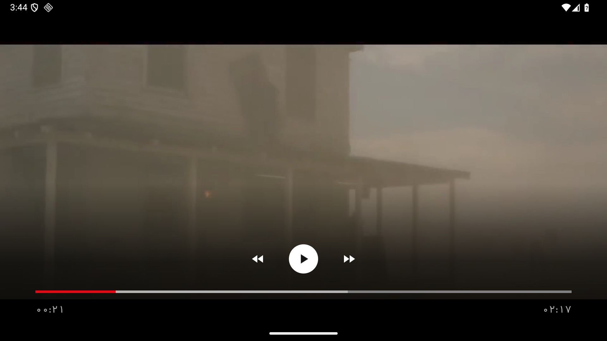<br>تریلر در خود برنامه |
| 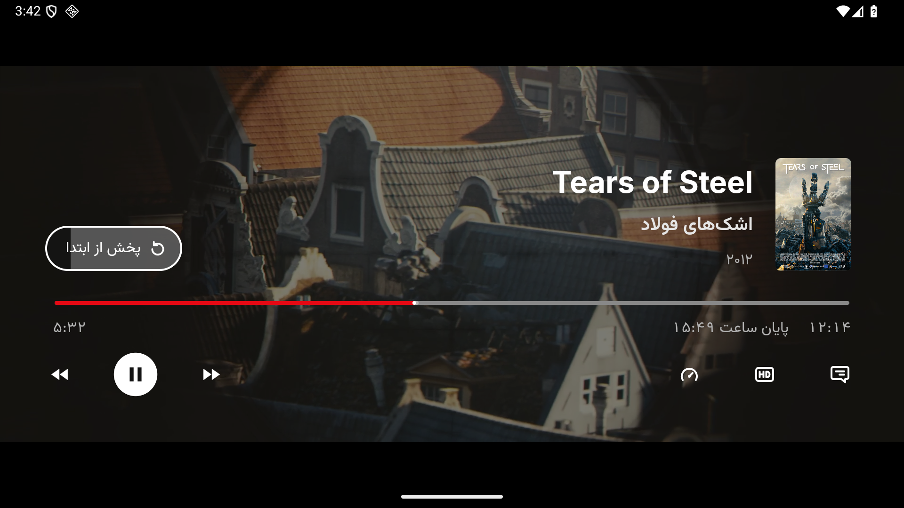<br>ادامهٔ تماشا | 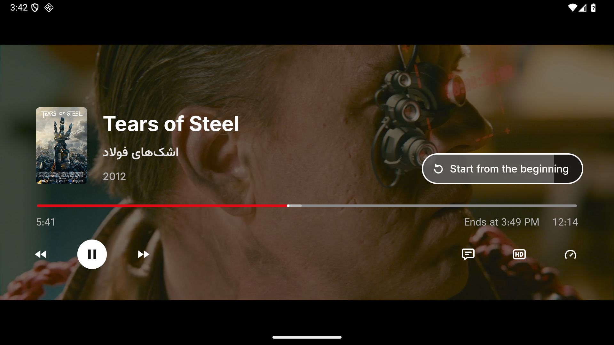<br>پخش‌کننده با رابط انگلیسی |
| 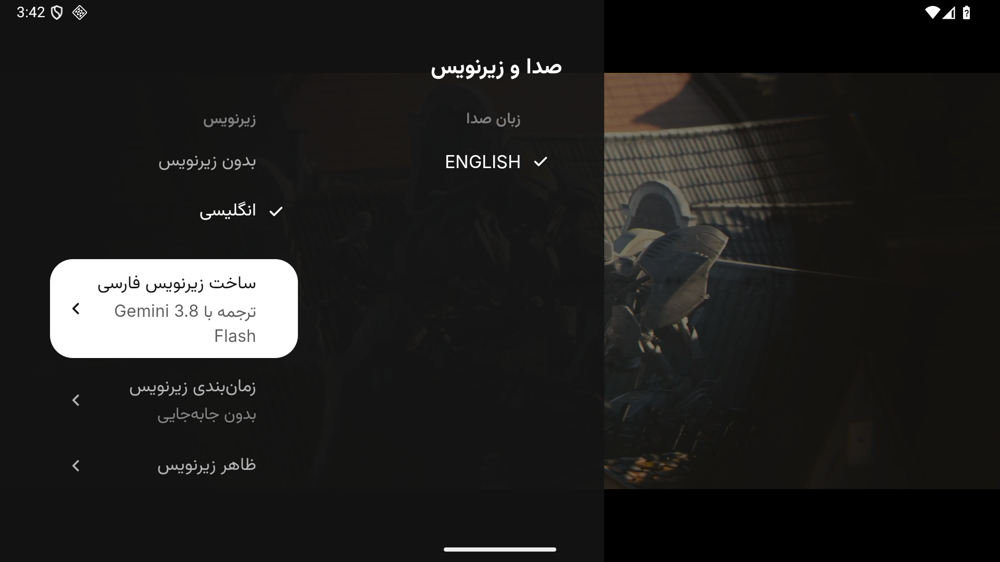<br>ساخت زیرنویس فارسی | 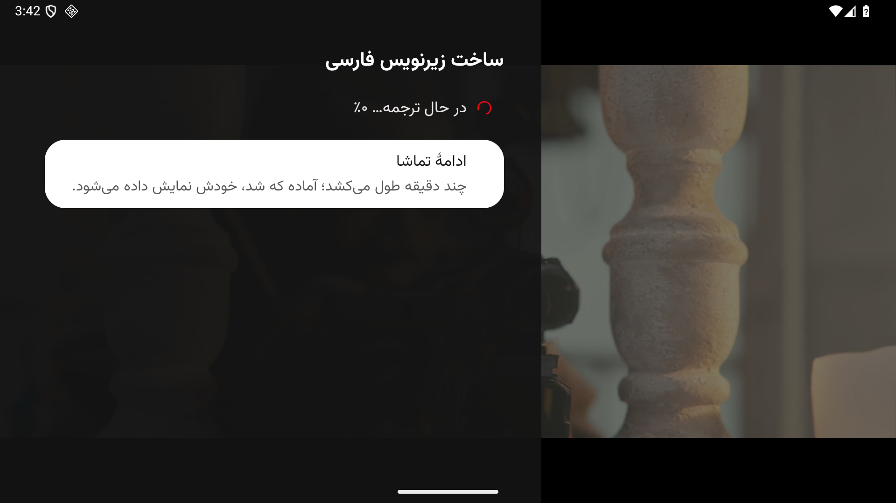<br>ترجمه در حال انجام |
| 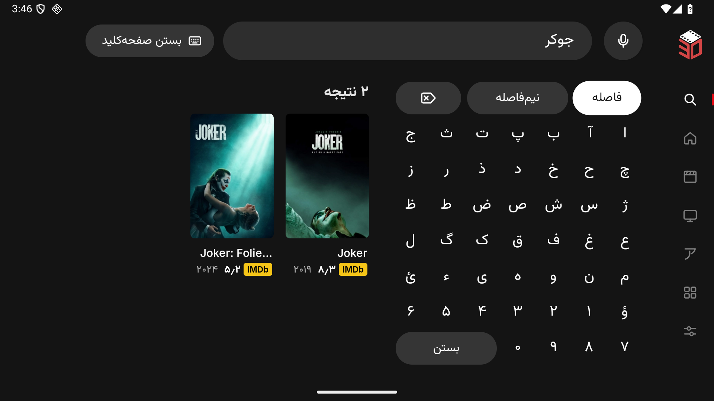<br>جست‌وجو با صفحه‌کلید فارسی | 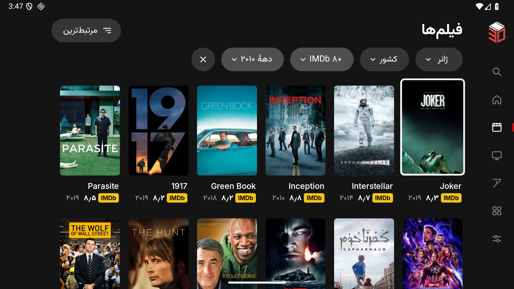<br>فیلتر فیلم‌ها |
| 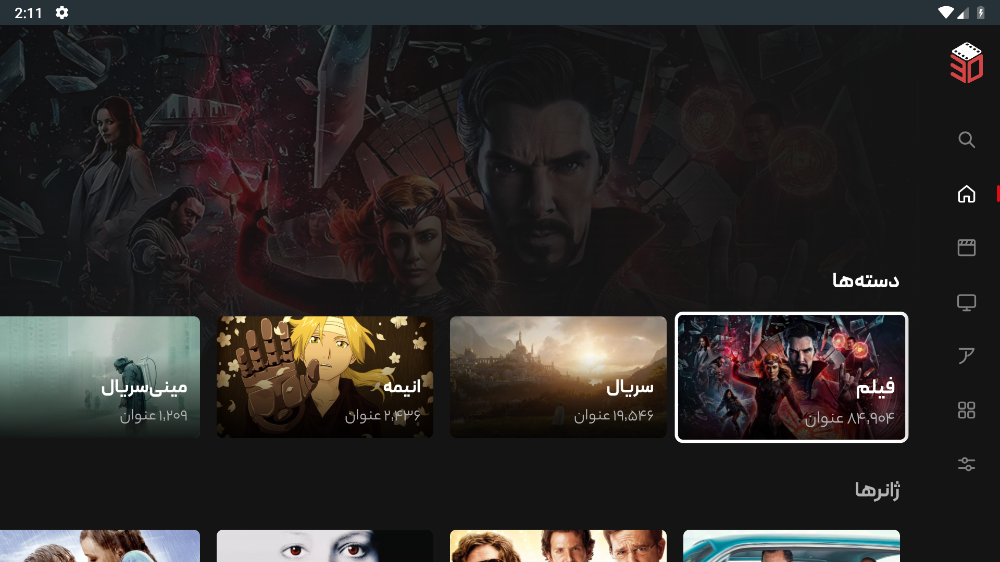<br>دسته‌ها و ژانرها | 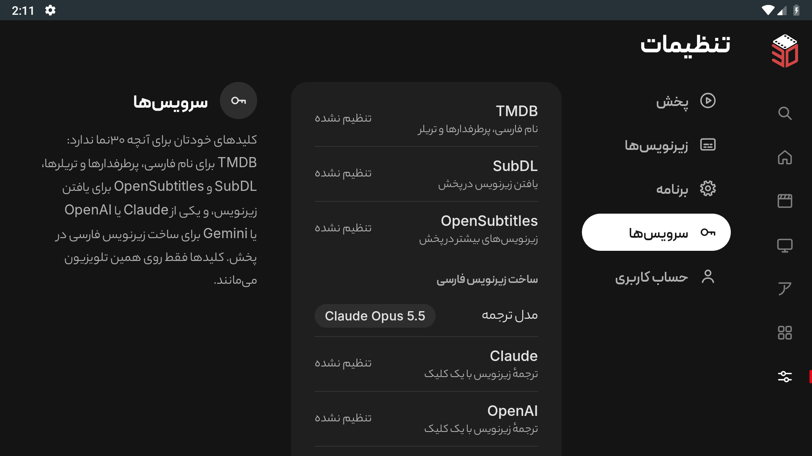<br>تنظیمات سرویس‌ها |

تصویرها از شبیه‌ساز اندروید گرفته شده‌اند ([جزئیات](DEVELOPMENT.md#screenshots)). فیلمی که در تصویرهای پخش‌کننده می‌بینید، [Tears of Steel](https://mango.blender.org/) ساخت بنیاد بلندر است (مجوز CC BY 3.0؛ پوستر از [ویکی‌مدیا کامانز](https://commons.wikimedia.org/wiki/File:Tos-poster.png)).

نام و نشان ۳۰نما متعلق به ۳۰نماست. انتشار این برنامه به معنای وابستگی به ۳۰نما یا اجازهٔ استفاده از نشان آن نیست و حقوق فونت‌ها برای صاحبانشان محفوظ است.

</div>
