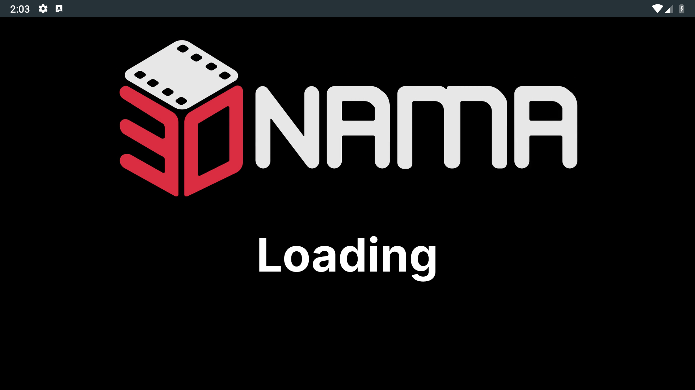
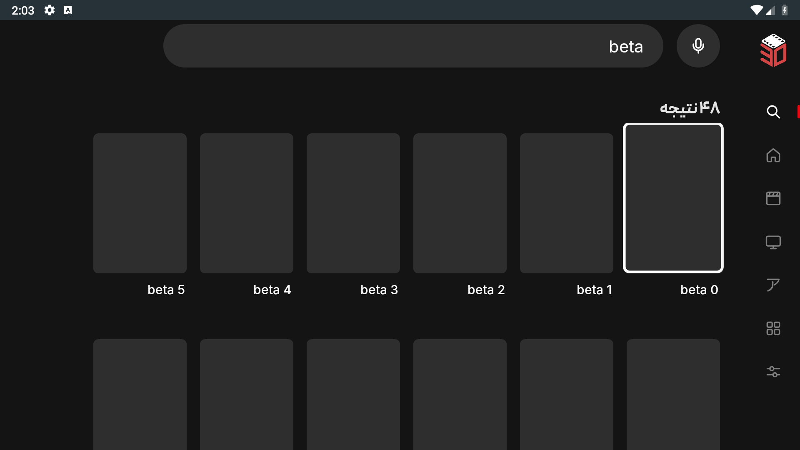
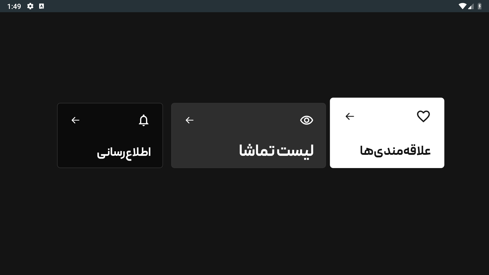
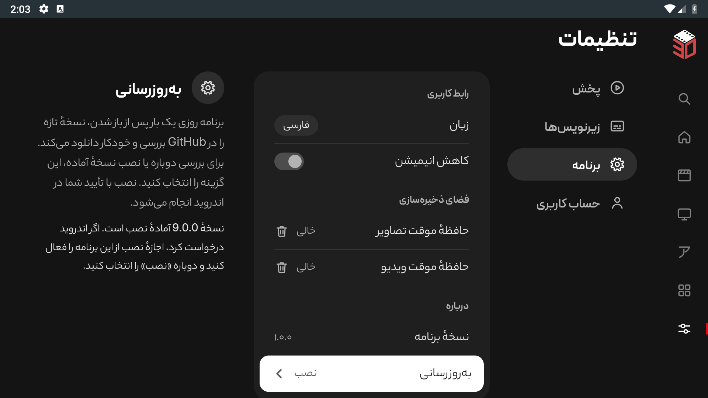
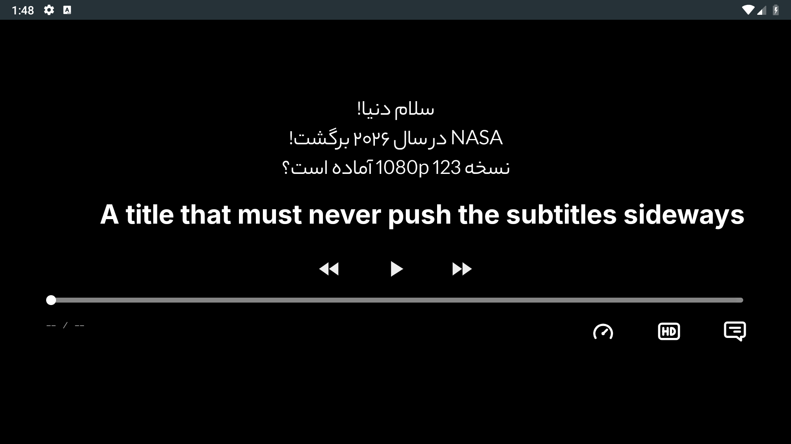

# 30namaTV

An **unofficial, independent** native Kotlin app for browsing and watching 30nama on Android TV. **This is not the official 30nama app and is not affiliated with or endorsed by 30nama.** Built with Android Views, Leanback and Media3, with Persian and English interfaces and D-pad navigation. A 30nama account/subscription is required for subscription content.

[](https://github.com/soeleia/30namaTV/actions/workflows/android.yml)

Android 6.0+ (API 23). Universal APK; no React Native runtime. Release builds use R8 optimization and resource shrinking. Browsing stays available while account/menu extras load, posters are decoded to display size, and search requests are cancelled when replaced.

Search uses a six-column vertical grid. Genres opens a dedicated four-column page from the short home preview, with every genre and its existing catalogue preserved.

## Install

Download `30namaTV.apk` from [Releases](https://github.com/soeleia/30namaTV/releases), or the `optimized-apk` artifact of a successful [Actions run](https://github.com/soeleia/30namaTV/actions).

Enable installation from your chosen file manager on the TV and open the APK, or use ADB:

```sh
adb connect YOUR_TV_IP:5555
adb -s YOUR_TV_IP:5555 install -r 30namaTV.apk
```

The application ID is `com.doxigo.tv30`. Public builds use one dedicated release key so subsequent public APKs install as updates. Earlier personal test APKs used a different local debug key: moving from those to the public release requires uninstalling the old build, which removes its local settings/login. The separately supplied TV test APK retains the original test key for an in-place update.

## Updates

After opening, the app checks the latest stable GitHub release once a day and automatically downloads a newer APK using Android's Download Manager. Downloads continue in the background. Open **Settings > App > App update** to see progress, check again or install a ready update. Android requires installation confirmation and may ask you to allow updates from this app.

Before installation, the app verifies the package name, newer version code and signing certificate. It rejects incompatible or invalid APKs. The first migration from an older personal test key to the public release key still requires the manual installation described above.

## Build locally

Install Android Studio, JDK 21 and these SDK packages:

```sh
sdkmanager 'platforms;android-37.0' 'build-tools;36.0.0' 'build-tools;37.0.0' 'platform-tools'
git clone https://github.com/soeleia/30namaTV.git
cd 30namaTV
printf 'sdk.dir=%s\n' "$ANDROID_HOME" > local.properties
./gradlew :app:assembleRelease
```

The APK is `app/build/outputs/apk/release/app-release.apk`. Android Studio's bundled JDK 21 also works. The Gradle wrapper verifies its distribution checksum. A local build uses your Android debug key unless all four `RELEASE_*` variables described below are supplied.

The public checkout includes OFL-licensed Inter and Vazirmatn, so it builds without private font files. Maintainer APKs retain the requested Peyda headings and Yekan Bakh body text; see [fonts and build inputs](docs/setup.md#fonts). English text uses Inter throughout.

Optional TMDB enhancements use `tmdb.token=YOUR_TMDB_READ_TOKEN` in ignored `local.properties`. Core 30nama functionality works without it. A token compiled into an APK can be extracted; never put an account password or private server credential there.

## Checks and screenshots

```sh
./gradlew :app:testDebugUnitTest :app:lintRelease :app:assembleDebug :app:assembleDebugAndroidTest
python3 scripts/tv-checks.py --serial emulator-5554
```

Use a disposable emulator. Fixture checks replace local preferences and use mocked account data; the runner rejects physical devices. They cover startup/cancellation, logo playback and cleanup, five-second control hiding, forward-seek resume, cancelled/backward seeks, column alignment, subtitle direction and centering, title clipping, intro/recap countdown, My Lists, vertical search, the complete genre page, update validation/status and trailer playback/lifecycle.

The trailer check attempts the public Animals trailer. If its CDN is unreachable, logs state `PUBLIC_UNAVAILABLE` and use a silence fixture for interaction/lifecycle checks. That result does not certify live CDN playback.

GitHub Actions runs the instrumented debug APK on an Android 11 TV emulator with two cores and 1.5 GB RAM. The optimized release APK also passes build, full lint, signature and ZIP alignment checks. Each run uploads APKs, lint/unit-test reports, instrumentation logs and screenshots. See [setup and release instructions](docs/setup.md) and [manual Sony TV checks](docs/testing.md). Emulator timing does not establish performance on a 2017 Sony TV.

## Interface












Screenshots use test fixtures, not private account data. The original logo and loading animation are documented in [branding provenance](docs/branding.md). 30nama branding and third-party font licenses retain their respective owners' rights; publishing this client does not imply affiliation or a license to reuse those assets separately.
