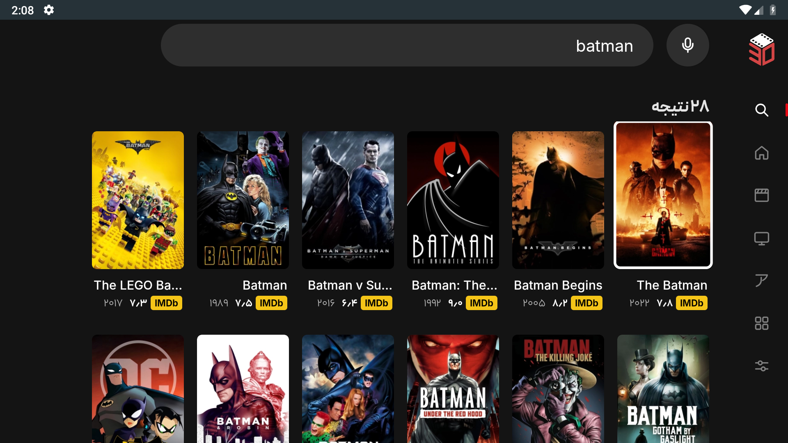
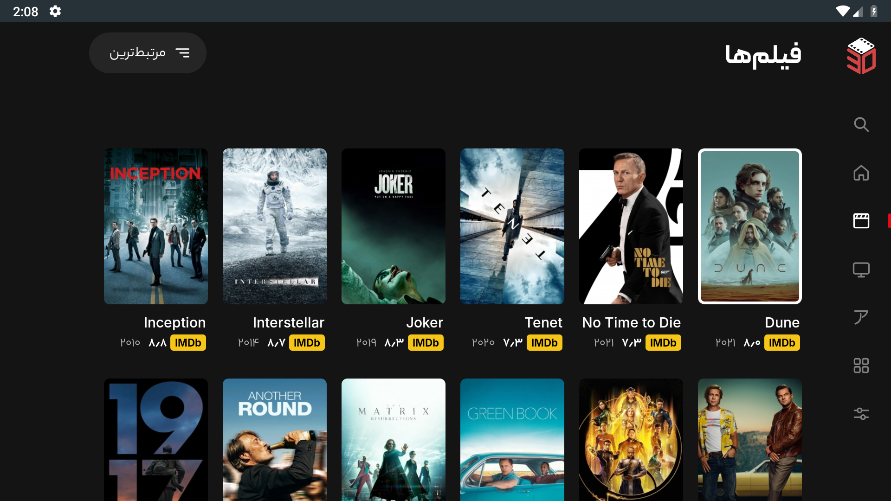

# 30namaTV

An **unofficial, independent** native Kotlin app for browsing and watching 30nama on Android TV. **This is not the official 30nama app and is not affiliated with or endorsed by 30nama.** Built with Android Views, Leanback and Media3, with Persian and English interfaces and D-pad navigation. A 30nama account/subscription is required for subscription content.

[](https://github.com/soeleia/30namaTV/actions/workflows/android.yml)

Android 6.0+ (API 23). Universal APK; no React Native runtime. Release builds use R8 optimization and resource shrinking. Browsing stays available while account/menu extras load, posters are decoded to display size, and search requests are cancelled when replaced.

Search uses a six-column vertical grid. Home shows every genre in its row, ending in a link to the dedicated four-column genre page.

## Features

- **Home.** 30nama's promoted titles page left and right on a hero with one **More info** button; the remote's play key starts the title. Home draws at once from the last saved copy, then refreshes in place. The artwork of the titles next to the one in focus is fetched ahead, so moving along a row rarely waits.
- **Posters.** Hold OK on any poster for quick actions: More info, add or remove it from your three lists, and the trailer when one exists. On Continue Watching, holding OK offers to remove the title or open its page.
- **Trailers.** The title page's **Trailer** plays in the app's own player: Aparat's upload in Iran, with no VPN and often with Persian subtitles, and the studio's YouTube trailer elsewhere, each falling back to the other. YouTube's mark on the button says when it plays from YouTube; hold OK on it to choose. YouTube needs youtube.com within reach and a WebView from 2019 on.
- **Search.** Recent searches return when the box is empty, above 30nama's suggestions.
- **Player.** The controls open on play/pause. Left and right scrub in five-second steps that speed up while held, and the seek lands a second after the last press. The light part of the seek bar shows what is ready, including the disk read-ahead (Settings > Playback > Preload), and the next episode's opening is fetched during the credits. The title's Persian name sits under the English one.
- **Subtitles.** **Find subtitles** searches SubDL and OpenSubtitles for the film or exact episode, Persian first, and loads the chosen file without stopping playback, converting old Windows-1256 Persian files. **Make Persian subtitles** has Claude, OpenAI or Gemini translate the English subtitle (30nama's, or one from the subtitle sites) into natural, spoken Persian in a few minutes while the film plays, then switches it on. **Subtitle timing** shifts any subtitle earlier or later in quarter-second steps.
- **Episodes.** Watched episodes carry a check, partly watched ones a progress bar and the minutes left, and Play resumes where you are. The history is kept on the TV (30nama keeps one position per title) and cleared on sign-out.

## Install

Download `30namaTV.apk` from [Releases](https://github.com/soeleia/30namaTV/releases), or the `optimized-apk` artifact of a successful [Actions run](https://github.com/soeleia/30namaTV/actions).

Enable installation from your chosen file manager on the TV and open the APK, or use ADB:

```sh
adb connect YOUR_TV_IP:5555
adb -s YOUR_TV_IP:5555 install -r 30namaTV.apk
```

The application ID is `com.doxigo.tv30`. Public builds use one dedicated release key so subsequent public APKs install as updates. Earlier personal test APKs used a different local debug key: moving from those to the public release requires uninstalling the old build, which removes its local settings/login. The separately supplied TV test APK retains the original test key for an in-place update.

## Updates

After opening, the app checks the latest stable GitHub release once a day and automatically downloads a newer APK using Android's Download Manager. Downloads continue in the background. Open **Settings > App > App update** to see progress, check again or install a ready update. Android requires installation confirmation and may ask you to allow updates from this app.

Before installation, the app verifies the package name, newer version code and signing certificate. It rejects incompatible or invalid APKs. The first migration from an older personal test key to the public release key still requires the manual installation described above.

## Service keys

TMDB, the player's subtitle search and its Persian subtitle maker use API keys that each viewer supplies. Open **Settings > Services** and select a service. Scan the QR code with a phone on the same Wi-Fi: it opens a page served by the TV that links to where the key is made and sends the pasted key straight to the TV. You can also type the key with the TV's keyboard or the Google TV app, or use **Paste**. The sheet checks the key, says whether it works, and keeps it in the app's private storage on that TV. Without a key that feature stays off; browsing and 30nama playback need none.

- **TMDB** adds the trending row, Persian names 30nama lacks, More Like This, trailers and episode stills. Its API page offers an API key and an API read access token; either works.
- **SubDL** and **OpenSubtitles** power **Find subtitles** in the player (Audio & Subtitles → Subtitles), which appears once either has a key. A free OpenSubtitles key downloads five subtitles a day.
- **Claude**, **OpenAI** and **Gemini** power **Make Persian subtitles** in the same column. **Translation model**, above their keys, picks the model and with it the service: Claude Opus 5.5 (the most faithful Persian, about $0.92 a two-hour film), Claude Sonnet 5.5 or GPT-6.1 Sol (about $0.46), GPT-6 Astra (about $2.30), or Gemini 3.8 Flash (free within Gemini's free tier, but it slips more often). Until you pick one, the best model of the first service with a key, in that order, translates; the paid ones charge your own account. The result is kept on the TV, so watching again costs nothing. These providers refuse connections from Iran without a VPN.

## Build locally

Install Android Studio, JDK 21 and these SDK packages:

```sh
sdkmanager 'platforms;android-37.0' 'build-tools;36.0.0' 'build-tools;37.0.0' 'platform-tools'
git clone https://github.com/soeleia/30namaTV.git
cd 30namaTV
printf 'sdk.dir=%s\n' "$ANDROID_HOME" > local.properties
./gradlew :app:assembleRelease
```

The APK is `app/build/outputs/apk/release/app-release.apk`. Android Studio's bundled JDK 21 also works. The Gradle wrapper verifies its distribution checksum. A local build uses your Android debug key unless all four `RELEASE_*` variables described below are supplied.

The public checkout includes OFL-licensed Inter and Vazirmatn, so it builds without private font files. Maintainer APKs retain the requested Peyda headings and Yekan Bakh body text; see [fonts and build inputs](docs/setup.md#fonts). English text uses Inter throughout.

Public APKs carry no API keys (see [service keys](#service-keys)). For your own builds, ignored `local.properties` can hold fallbacks used while no key is saved in Settings: `tmdb.token=`, `subdl.key=`, `opensubtitles.key=`, `gemini.key=`, `anthropic.key=` and `openai.key=` ([details](docs/setup.md#service-keys)). Keys compiled into an APK can be extracted, so don't share an APK built with yours, and never put an account password there.

## Checks and screenshots

```sh
./gradlew :app:testDebugUnitTest :app:lintRelease :app:assembleDebug :app:assembleDebugAndroidTest
python3 scripts/tv-checks.py --serial emulator-5554
```

Use a disposable emulator. Fixture checks replace local preferences and use mocked account data; the runner rejects physical devices. They cover startup/cancellation, logo playback and cleanup, five-second control hiding, play/pause focus, accelerating and self-landing seeks, cancelled/backward seeks, column alignment, Persian lines fitting their width, subtitle direction and centering, making Persian subtitles (part by part, with a refused key), title clipping, intro/recap countdown, watched episodes, My Lists, vertical search and recent searches, the complete genre page, update validation/status and trailer playback/lifecycle.

The trailer check attempts the public Animals trailer. If its CDN is unreachable, logs state `PUBLIC_UNAVAILABLE` and use a silence fixture for interaction/lifecycle checks. That result does not certify live CDN playback.

GitHub Actions runs the instrumented debug APK on an Android 11 TV emulator with two cores and 1.5 GB RAM. The optimized release APK also passes build, full lint, signature and ZIP alignment checks. Each run uploads APKs, lint/unit-test reports, instrumentation logs and screenshots. See [setup and release instructions](docs/setup.md) and [manual Sony TV checks](docs/testing.md) and [performance evidence](docs/performance.md). Emulator timing does not establish performance on a 2017 Sony TV.

## Interface

| | |
|:-:|:-:|
| <br>Home | <br>Home rows |
| <br>Title page | <br>Trailer, played in the app |
| <br>Search | <br>Movies |
| <br>Categories and genres | <br>Settings: services |

Screenshots show the optimized release browsing the live catalogue as a guest on a disposable Android 9 emulator, after artwork loaded. The trailer is Aparat's re-upload, with its uploader's watermark. They contain no mocked results or private account data. The emulator's status bar is visible; these are unmodified captures, not photos of a physical TV. The original logo and loading animation are documented in [branding provenance](docs/branding.md). 30nama branding and third-party font licenses retain their respective owners' rights; publishing this client does not imply affiliation or a license to reuse those assets separately.
