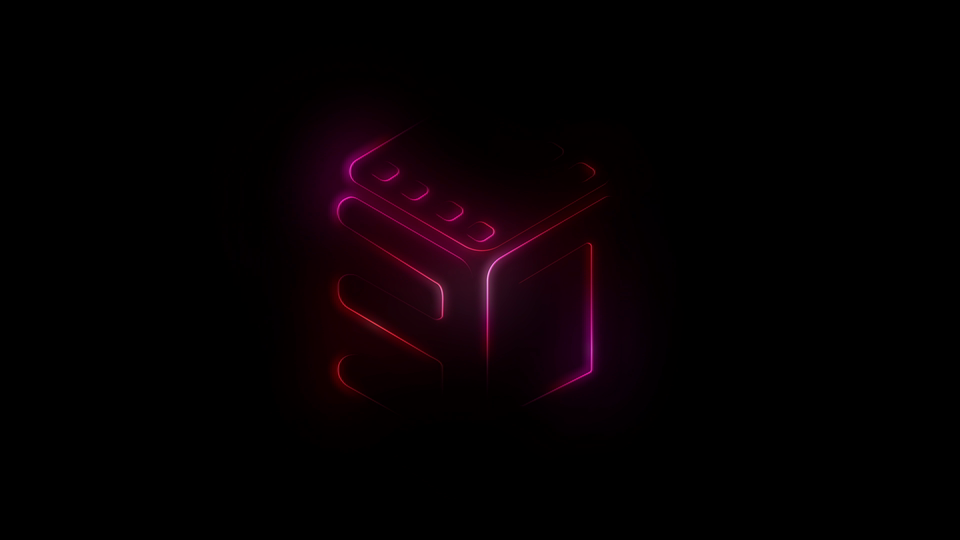

# 30namaTV branding provenance

The user requested the original 30nama logo and loading animation from `30tv-3.2.3.apk`, plus the exact display name `30namaTV`. The application ID remains `com.doxigo.tv30` so existing installations can update.

Source APK SHA-256: `569ea759f3366aa994bad67b40c1e209d36e0b7a73fe4afd12628722ffcc20e9`.

The original launch implementation references `asset:///motionlogo/30nama-motionlogo.mp4` with autostart enabled, controls disabled and repeat disabled, in a centered 960x540 view. After 6500 ms, if loading is still pending, it scales the motion logo to 0.7 and translates it upward by 200 logical pixels over 400 ms while displaying Loading. The native intro preserves that timing and scale, bounds the upward shift to 20% of the viewport or 200 dp, and moves the loading label downward to keep both visible across TV densities. It uses the existing Media3 dependency, cancels on ready content, releases its decoder on disposal/stop, and bypasses motion when reduced motion is enabled. Its opacity breathing uses native animation, approximately following the original 1.5-second transitions.

No original application code, account data or third-party player credentials were copied. The separate GIF and Lottie variants are not used by the original launch component and are not shipped.

## Shipping assets

### drawable-nodpi/nama_logo_light.png

Source entry: `res/sC.png`. Resized from 3066x1060 to 640x221 after expanding the palette to RGBA; transparent source colors retained.

Source SHA-256: `dfde169af8bcebce95f3bdd21ba2e9ab882ec8809db1ca8a4e5956e634dd5fd4`.

Shipping SHA-256: `28353eb07e562c0c9ef17308c8d7fbe729d535c963f577b6b00d0570fb28a257`.

### drawable-nodpi/nama_logo_compact.png

Source entry: `res/0F.png`. Resized from 836x1060 to 160x203 after expanding the palette to RGBA; transparent source colors retained.

Source SHA-256: `67cf43d7bb2214288574327fbd1c1e499fc2fda2c2d3a97ee4fc9748fa3ca085`.

Shipping SHA-256: `6be49139e36a46942a2bf1c318da390147dccff63499675883483f80161bab1f`.

### drawable-nodpi/nama_tv_banner.png

Source entry: `res/sQ.png`. Original 320x180 banner copied unchanged.

Source SHA-256: `5a93fc930cf5a746d980cd5c9b08c1cf9ac720d4374ac3ffb8c1148d59467704`.

Shipping SHA-256: `5a93fc930cf5a746d980cd5c9b08c1cf9ac720d4374ac3ffb8c1148d59467704`.

### mipmap-mdpi/ic_nama.png

Source entry: `res/u3.png`. Original launcher copied unchanged; all five APK density variants are included.

Source SHA-256: `f2fb60c30b00e0c5ac2df4dbc1ef10fc36b0e7855b45c68da858677c7fbfc8e8`.

Shipping SHA-256: `f2fb60c30b00e0c5ac2df4dbc1ef10fc36b0e7855b45c68da858677c7fbfc8e8`.

### raw/nama_motion.mp4

Source entry: `assets/motionlogo/30nama-motionlogo.mp4`. Original motion re-encoded at 1920x1080 H.264 Constrained Baseline level 4.0; same 159 frames, 24 fps and 6.625-second duration.

Source SHA-256: `5204a479049a5c2d9c3efecb2b12af8b68a0d6fce31c66ce5cb620324bdb1bf7`.

Shipping SHA-256: `9bea08836bfee0bf8d65bef73ed83c80421e06039439f4b8ad9ee5e503cc00fb`.

## Original loading reference

`original-motion-1s.png` is a frame exported at one second from the original APK motion video and scaled to 960x540 for review. It is documentation only and is not included in the APK.

Reference PNG SHA-256: `a4c199b1cdc951873c863c3dc597d95345d1d560e3ea4ae9ff37c6a6a022d006`.

## Original launcher density variants

All are copied byte-for-byte from the supplied APK.

| Density | APK entry | Shipping resource | SHA-256 |
| --- | --- | --- | --- |
| mdpi | `res/u3.png` | `mipmap-mdpi/ic_nama.png` | `f2fb60c30b00e0c5ac2df4dbc1ef10fc36b0e7855b45c68da858677c7fbfc8e8` |
| hdpi | `res/SD.png` | `mipmap-hdpi/ic_nama.png` | `f2fb60c30b00e0c5ac2df4dbc1ef10fc36b0e7855b45c68da858677c7fbfc8e8` |
| xhdpi | `res/jy.png` | `mipmap-xhdpi/ic_nama.png` | `f2fb60c30b00e0c5ac2df4dbc1ef10fc36b0e7855b45c68da858677c7fbfc8e8` |
| xxhdpi | `res/D2.png` | `mipmap-xxhdpi/ic_nama.png` | `f2fb60c30b00e0c5ac2df4dbc1ef10fc36b0e7855b45c68da858677c7fbfc8e8` |
| xxxhdpi | `res/CG.png` | `mipmap-xxxhdpi/ic_nama.png` | `f2fb60c30b00e0c5ac2df4dbc1ef10fc36b0e7855b45c68da858677c7fbfc8e8` |
