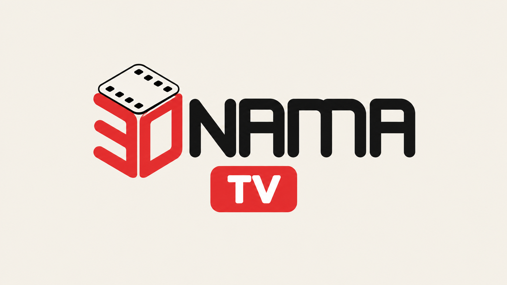

# 30namaTV branding provenance

The user requested the original 30nama logo and loading animation from `30tv-3.2.3.apk`, the display name `30namaTV`, and distinct launcher artwork for this unofficial client. The application ID remains `com.doxigo.tv30` so existing installations can update.

Source APK SHA-256: `569ea759f3366aa994bad67b40c1e209d36e0b7a73fe4afd12628722ffcc20e9`.

The original launch implementation references `asset:///motionlogo/30nama-motionlogo.mp4` with autostart enabled, controls disabled and repeat disabled, in a centered 960x540 view. After 6500 ms, if loading is still pending, it scales the motion logo to 0.7 and translates it upward by 200 logical pixels over 400 ms while displaying Loading. The native intro preserves that timing and scale, bounds the upward shift to 20% of the viewport or 200 dp, and moves the loading label downward to keep both visible across TV densities. It uses the existing Media3 dependency, cancels on ready content, releases its decoder on disposal/stop, and bypasses motion when reduced motion is enabled. Its opacity breathing uses native animation, approximately following the original 1.5-second transitions.

No original application code, account data or third-party player credentials were copied. The separate GIF and Lottie variants are not used by the original launch component and are not shipped.

## Shipping assets

### drawable-nodpi/nama_logo_light.png

Source entry: `res/sC.png`. Resized from 3066x1060 to 640x221 after expanding the palette to RGBA; transparent source colors retained.

Source SHA-256: `dfde169af8bcebce95f3bdd21ba2e9ab882ec8809db1ca8a4e5956e634dd5fd4`.

Shipping SHA-256: `28353eb07e562c0c9ef17308c8d7fbe729d535c963f577b6b00d0570fb28a257`.

### drawable-nodpi/nama_logo_compact.png

Source entry: `res/0F.png`. Resized from 836x1060 to 160x203 after expanding the palette to RGBA; transparent source colors retained.

Source SHA-256: `67cf43d7bb2214288574327fbd1c1e499fc2fda2c2d3a97ee4fc9748fa3ca085`.

Shipping SHA-256: `6be49139e36a46942a2bf1c318da390147dccff63499675883483f80161bab1f`.

### Launcher banner and icons

The launcher artwork is an adaptation, not a copy of the official app thumbnail. The original film-cube identity is retained on a warm white tile with a red TV badge. The in-app logos and original motion stay unchanged.

The built-in imagegen tool generated the two source images in `docs/branding/`. Prompt for the banner: "Keep the original red film-cube identity, use a warm off-white background and dark 30NAMA wordmark, replace androidtv with a red TV badge, and make a clean 16:9 launcher tile without shadows or extra text." Prompt for the icon: "Keep the original film-cube identity on a warm off-white square, add a centered red TV badge beneath the cube, and use simple shapes that remain legible at 48 pixels."

`sips` resized the sources into Android resources. The TV banner is 320x180. Legacy icons use Android's standard 48/72/96/144/192-pixel sizes. Android 8 and newer use an adaptive icon with a 22% foreground inset so the logo and badge fit launcher masks.

### raw/nama_motion.mp4

Source entry: `assets/motionlogo/30nama-motionlogo.mp4`. Original motion re-encoded at 1920x1080 H.264 Constrained Baseline level 4.0; same 159 frames, 24 fps and 6.625-second duration.

Source SHA-256: `5204a479049a5c2d9c3efecb2b12af8b68a0d6fce31c66ce5cb620324bdb1bf7`.

Shipping SHA-256: `9bea08836bfee0bf8d65bef73ed83c80421e06039439f4b8ad9ee5e503cc00fb`.

## Original loading reference

`original-motion-1s.png` is a frame exported at one second from the original APK motion video and scaled to 960x540 for review. It is documentation only and is not included in the APK.

Reference PNG SHA-256: `a4c199b1cdc951873c863c3dc597d95345d1d560e3ea4ae9ff37c6a6a022d006`.

## Launcher resource checksums

| Resource | SHA-256 |
| --- | --- |
| `drawable-nodpi/nama_tv_banner.png` | `c5541dc751f0bc2210a3158d000c474902dfbe1619507a2b577be16d36a91f00` |
| `drawable-nodpi/nama_icon.png` | `e4eb064347d4b008f471c200e31a4775aa36d6cce9a38b88a7c46596bd85fb7a` |
| `mipmap-mdpi/ic_nama.png` | `e374be701b2d6f989bdb711c924a3d72dbf0e38c3f0f8193be926c92e0a6aa52` |
| `mipmap-hdpi/ic_nama.png` | `9171fa98473f7f583f489314cf6873b3da84b8f29ddbcb268bbfeeabe5225c4e` |
| `mipmap-xhdpi/ic_nama.png` | `a2772ab0ffe3b5112a7016cf7df3bed40542bfce09c5c634a68d10d96e649d1e` |
| `mipmap-xxhdpi/ic_nama.png` | `f5cd2ba889c86efb968466803009e5c495ef770ed0d7721d3f4914b941705b54` |
| `mipmap-xxxhdpi/ic_nama.png` | `a128d3f57d1c18f79c35186f6dd7a6e75c84bfc51b2fc79799e57758a600e0fe` |
